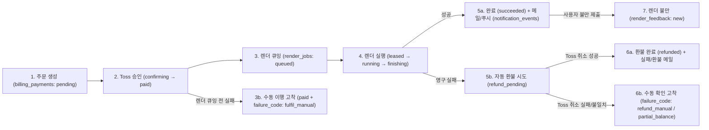
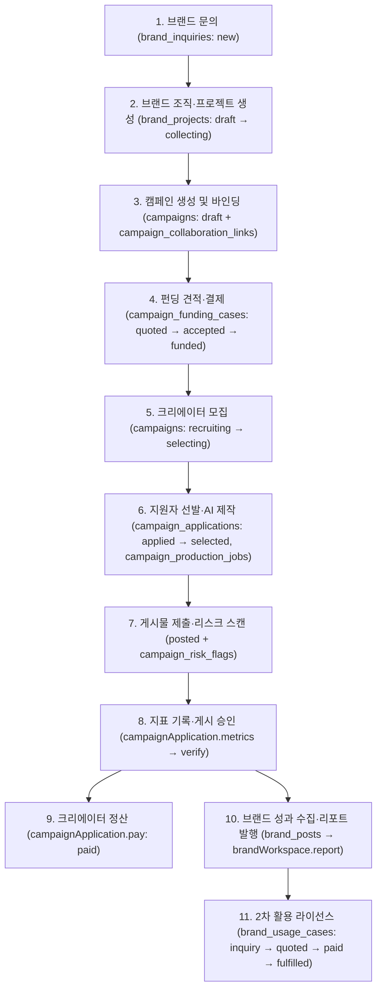

# ADMIN-AUDIT.md — TWINGS Admin 인과 지도 및 전수 감사

> 작성일: 2026-10-31  
> 기준 브랜치: `origin/main` (`9a6ae23`)  
> 범위: `app/(admin)/**`, `app/(brand)/**`, `components/admin/**`, `components/brand-workspace/**`, `lib/admin/**`, 관련 도메인 서비스(`lib/billing/*`, `lib/renders/*`, `lib/prompts/*`, `lib/campaigns/*`, `lib/brands/*`, `lib/creator-platform/*`, `lib/influencers/*`, `lib/recipes/*`)

---

## 0. 1차 가설(H1~H6) 검증 결과 요약

코드(`file:line`)와 로컬 실행 화면(`http://localhost:3177/admin`, `/brand`)을 대조해 6개 가설을 검증한 결과다.

| 가설 | 판정 | 핵심 근거 (`file:line`) |
| --- | --- | --- |
| **H1.** 홈의 "다음 할 일"이 위험을 다 담지 못한다. `countManualTossPayments`는 불러오지만 `adminNextActions`에 넘기지 않고, 렌더 실패와 펀딩도 없다. | **확인 (확장됨)** | `app/(admin)/admin/page.tsx:142,148`에서 `summarizeRenderJobs(sql)`와 `countManualTossPayments(sql)`를 조회하지만 `adminNextActions`(`app/(admin)/admin/page.tsx:171-182`, `lib/admin/workflow.ts:26-56`) 인자에는 넘기지 않는다. 추가로 ① 리스크 워커 중단·사망 작업(`risk.workerUnavailable`, `risk.dead`, `page.tsx:161-163`), ② 캠페인 펀딩(`/admin/funding`의 보상 제안 `proposed`, 만료 견적, 결제 `review`/`refund_pending`), ③ 2차 활용(`/admin/brand-workspace/usage`의 `inquiry`, `blocked_after_payment`, 결제 `review`), ④ 정기결제 점검(`/admin/subscriptions`의 `charge_exhausted_review`/`provider_review_required`, `app/(admin)/admin/subscriptions/page.tsx:29-30`), ⑤ 콘테스트 출품 검수(`/admin/contests`의 `pending`, `app/(admin)/admin/contests/page.tsx:532`)가 홈 대기열에서 빠져 있다. 게다가 홈 하단 요약 카드(`page.tsx:364-379`)에서 `dashRendersFailed`와 `dashPaymentsManual` 모두 렌더 보드가 없어 `${ADMIN_INQUIRIES_PATH}?kind=feedback&status=new`(렌더 불만 문의함)로 잘못 연결된다. |
| **H2.** 할 일 링크가 처리 지점까지 가지 못한다. `posts`와 `applicants`가 모두 `/admin/campaigns`로 간다. | **확인** | `lib/admin/workflow.ts:41-42`에서 `posts`와 `applicants`가 모두 `"/admin/campaigns"`로만 연결된다. `/admin/campaigns`(`app/(admin)/admin/campaigns/page.tsx`)에는 정산 대기열(`#payout-queue`)만 상단에 있고, 게시물 검수나 지원자 선발은 개별 캠페인 상세(`/admin/campaigns/[id]#posts`, `#applications`)에 들어가야 처리할 수 있다. `creatorApplications`도 `"/admin/community#applications"`로 가지만 10개 패널이 2단으로 섞인 페이지 우측 열(`app/(admin)/admin/community/page.tsx:67-81`)에 묻혀 있다. |
| **H3.** 브랜드와 크리에이터 관련 정보가 여러 메뉴에 흩어져 있다. | **확인** | **브랜드 업무**가 4개 최상위 메뉴(`/admin/inquiries` 문의+렌더불만 혼재, `/admin/brand-workspace` 조직·캠페인·스튜디오 인박스·하위 `/usage`, `/admin/campaigns` 크리에이터 모집·정산, `/admin/funding` 캠페인 펀딩·보상 제안)로 쪼개져 있다. **크리에이터/메이커 업무**도 `/admin/community`(SNS 인증 `#social`, 메이커 지원 `#applications`, 레시피 검수 `#formats`, 스레드 `#threads`, 보상 청구 `#claims`, 평가 `#ratings`, 정산, 정책, 오퍼, 감사), `/admin/prompts`(템플릿), `/admin/subscriptions`(구독 출시 점검)에 분산되어 있다. |
| **H4.** `PLATFORM-2.0 §10`의 렌더 보드와 사용자 보기가 없다. `playbooks`는 옛 제품의 잔재일 수 있고, `contests`는 메뉴 그룹 밖에 있다. | **확인** | `docs/PLATFORM-2.0.md:262`(§10)가 규정한 **렌더 보드**(`/admin/renders`)와 **사용자 보기**(`/admin/users`) 라우트가 존재하지 않는다. `/admin/playbooks`(`app/(admin)/admin/playbooks/page.tsx`, `/admin/p/[id]/page.tsx`)는 이전 플레이북 제품의 잔재(`app/(admin)/admin/page.tsx:30-31` 주석 명시)임에도 `ADMIN_NAV_GROUPS`(`lib/admin/workflow.ts:7`)에 노출되어 있다. 반면 `/admin/contests`(`app/(admin)/admin/contests/page.tsx`)는 `AdminShell`(`components/admin/chrome.tsx:328,347`)에는 정의되어 있으나 `ADMIN_NAV_GROUPS`와 `ADMIN_NAV_PATHS`(`lib/admin/workflow.ts:3-23`)에 빠져 있어 내비게이션에 나타나지 않는다. |
| **H5.** `campaigns/[id]`, `contests`, 홈에 조회, 판단, 실행이 섞여 있다. | **확인** | 홈(`app/(admin)/admin/page.tsx:266-402`)에 긴급 대기열·고정 3단계 시작 가이드·템플릿 생성 배너·요약 카드가 섞여 있다. `/admin/campaigns/[id]/page.tsx`(668줄)는 참가자 선발·게시물 검수·수동 지표 입력·정산·AI 제작·상태 전환·전체 캠페인 수정 폼(15개 입력 필드)이 한 페이지에 나열된다. `/admin/contests/page.tsx`(575줄)는 콘테스트마다 상태 버튼·전체 수정 폼·출품작 검수·수상작 지정이 한 카드에 펼쳐져 있고, `/admin/brand-workspace/[id]/page.tsx`(399줄)와 `/admin/community/page.tsx`(10개 섹션)도 조회·판단·편집이 분리되지 않았다. |
| **H6.** 디자인 원본이 충돌한다. `§21.4`는 `#0000EE`, `IDENTITY.md`는 `#3875C5`다. | **확인** | 최신 원본인 `docs/design/IDENTITY.md:26-29`와 `lib/design/identity.ts:29`는 `#3875C5`(French blue) 단일 강조색과 "빨강 브랜드 강조 금지"를 선언한다. 반면 `docs/PLATFORM-2.0.md:659`(§21.4)는 구버전 `#0000EE` / `#1414B8`을 명시해 같은 문서 §21.5(`PLATFORM-2.0.md:704`, `#3875C5`) 및 `IDENTITY.md`와 충돌한다. CSS에서도 `app/(admin)/workspace.css:442,446`이 `.text-accent { color: #dc2626 }`와 `#0000ee`를 하드코딩하고, `app/(brand)/workspace.css:149`가 `--color-blue: #0000ee; --ys-red: #dc2626;`을 선언하며, `app/(brand)/workspace.css:996,1022,1268`에 폐기된 v1.2 색상 fallback(`#ed1e1e`, `#fad204`)이 남아 있다. |

---

## 1. 객체별 상태 전이 지도 (13개 핵심 도메인 객체)

운영자가 다루는 13개 도메인 객체의 DB 테이블, 상태 값, 상태 전이 트리거(Admin 오퍼레이션 및 자동 작업), 담당 주체, 멈춤(Stall) 감지 신호, 현재 노출 화면을 전수 추적했다.

| # | 객체 (DB 테이블) | 상태 (`status` / `state`) | 전이를 일으키는 오퍼레이션 (`/admin/do`) 및 자동 작업 | 담당자 | 멈춤(Stall)을 감지하는 신호 (`file:line`) | 신호가 보이는 화면 (현황 및 결함) |
| --- | --- | --- | --- | --- | --- | --- |
| **1** | **결제 — 단건·2차활용·펀딩·구독**<br>(`billing_payments`, `brand_usage_payments`, `campaign_funding_payments`, `creator_subscription_periods`) | **단건**(`0025_core_billing_payments.sql:12`): `pending` → `confirming` → `paid` → `refund_pending` → `refunded` / `failed`<br>**2차활용**(`lib/brands/usage/types.ts:57`): + `expired`, `review`<br>**펀딩**(`lib/campaigns/funding/payment.ts:70`): + `awaiting_deposit`, `expired`, `review`<br>**구독**(`0042_core_creator_subscriptions.sql:46`): `pending` → `charging` → `paid` / `failed` / `refund_pending` / `refunded` | **자동**: `POST /api/billing/toss/orders`(`createTossOrder`), `POST /api/billing/toss/confirm`(`confirmTossOrder`), `POST /api/billing/toss/webhook`(`app/api/billing/toss/webhook/route.ts:55-66`), `reconcilePendingTossOrders`(`lib/billing/reconcile.ts:19`), `GET /api/renders/tick`(`reconcileBrandUsagePayments`), `POST /api/creator-subscriptions/tick`<br>**Admin**: `brandUsage.reconcile`, `brandUsage.resolve`(`abandon`/`refund`), `campaignFunding.reconcile`, `campaignFunding.refund`, `campaignFunding.releaseUnpaid` | 고객(결제) → 시스템(승인·환불·대사) → **운영자**(수동 환불·수동 이행·검토 해소) | 1) **단건 수동 필요**: `(status='refund_pending' and failure_code in ('refund_manual','partial_balance')) or (status='paid' and failure_code='fulfil_manual')` (`lib/billing/toss-service.ts:788-795`)<br>2) **임대 만료 교착**: `status in ('confirming','paid','refund_pending') and lease_until <= now()` (`lib/billing/toss-service.ts:624-631`)<br>3) **2차활용·펀딩 검토**: `status in ('review','refund_pending')` (`app/(admin)/admin/brand-workspace/usage/[caseId]/page.tsx:205-209`, `app/(admin)/admin/funding/page.tsx:280-296`)<br>4) **구독 결제 실패 검토**: `status='failed' and failure_code in ('charge_exhausted_review','provider_review_required')` (`app/(admin)/admin/subscriptions/page.tsx:29-30`) | **결함 심각**: 단건 결제(`billing_payments`)는 **전용 목록·상세 화면과 Admin 해소 오퍼레이션이 아예 없다**. 홈 하단 카드 숫자(`dashPaymentsManual`, `app/(admin)/admin/page.tsx:375`)만 찍히고 클릭 시 `/admin/inquiries?kind=feedback&status=new`로 잘못 이동한다. (`docs/TOSS-CONTRACT.md:83`에서 SQL 수동 처리에 의존) |
| **2** | **렌더 작업**<br>(`render_jobs`, `render_feedback`, `notification_events`) | `queued` → `leased` → `running` (`finishing_at` 설정 시 마무리 단계) → `succeeded` / `failed` / `cancelled` (`lib/renders/repo.ts:17,348-360`, `lib/renders/service.ts:276-662`) | **자동**: `enqueueRender` (`POST /api/renders`), `runRenderPass` (`GET /api/renders/tick`, `app/api/renders/tick/route.ts:41`), `POST /api/renders/callback` (`handleArkCallback`), 완료 시 `notifyRenderFinished` → `notification_events` (`lib/renders/notify.ts:46-120`)<br>**Admin(캠페인 한정)**: `campaignProduction.retry`, `campaignProduction.resolve` (`lib/admin/campaign-production-operations.ts:14-31`)<br>**Admin(메이커 검수 한정)**: `platform.review` (`lib/admin/platform-operations.ts:24-41`) | 고객/크리에이터/메이커(요청) → 시스템(Ark/OpenAI/Kling/Gemini 호출) → **운영자**(실패 원인 확인·재시도·알림 재발송·불만 응대) | 1) **실패**: `status='failed'` (`error_code`, `error_detail`, `lib/renders/repo.ts:352`)<br>2) **지연/임대 고착(held)**: `status in ('queued','leased','running') and created_at < now() - interval '15 minutes'` (`lib/renders/repo.ts:353-355`, `app/(admin)/admin/page.tsx:120,142`)<br>3) **불만 접수**: `render_feedback.status='new'` (`lib/renders/feedback.ts:135`)<br>4) **캠페인 렌더 3회 실패**: `campaign_production_jobs` `attempts >= 3` & `retry_approved = false` (`lib/campaigns/production.ts:310-345`) | **결함 심각**: `PLATFORM-2.0 §10`의 **렌더 보드(`/admin/renders`)가 없다**. 일반 고객 렌더(`render_jobs`)는 실패 사유·비용·소요시간을 볼 화면도, 재시도·완료 메일 재발송 오퍼레이션도 없다. 캠페인 렌더만 `/admin/campaigns/[id]` 하단에 일부 보인다. |
| **3** | **템플릿**<br>(`prompt_items`) | `pending` → `published` / `rejected` ↔ `archived` (`lib/prompts/repo.ts:24`, `app/(admin)/admin/prompts/[id]/page.tsx:32-36`) | **자동/제출**: 사용자·메이커 제출 시 `pending`, 메이커 포맷 승인(`platform.manage` `accept_format`) 시 `published`로 자동 생성 (`lib/creator-platform/service.ts:238-278`)<br>**Admin**: `prompt.create`, `prompt.approve`, `prompt.reject`, `prompt.update`, `prompt.visibility`, `prompt.feature`, `prompt.archive`, `prompt.announce` (`lib/admin/prompt-operations.ts:468-476`) | 메이커/운영자(등록) → **운영자**(검수·공개·대표지정·발표 메일) | `prompt_items.status = 'pending'` (`countPromptsByStatus(sql, 'pending')`, `app/(admin)/admin/page.tsx:154`) | 홈 대기열(`templates`) → `/admin/prompts?status=pending` → `/admin/prompts/[id]` (`app/(admin)/admin/prompts/page.tsx`, `app/(admin)/admin/prompts/[id]/page.tsx`) |
| **4** | **캠페인**<br>(`campaigns`, `campaign_collaboration_links`, `campaign_production_configs`) | `draft` → `recruiting` → `selecting` → `running` → `completed` / `cancelled` (`lib/campaigns/state.ts:16-35`, 단방향 전이만 허용) | **Admin**: `campaign.create` (`app/(admin)/admin/campaigns/new/page.tsx:57`), `campaign.status`, `campaign.update` (`lib/admin/campaign-operations.ts:371-373`), `campaignCollaboration.bind` (`lib/admin/campaign-collaboration-operations.ts:98`), `campaignProduction.configure` (`lib/admin/campaign-production-operations.ts:32`) | **운영자**(스튜디오 PD) | 1) `status='recruiting'`인데 `apply_deadline_at < now()` 경과<br>2) `status in ('selecting','running')`인데 `post_deadline_at < now()` 경과<br>3) 브랜드 프로젝트와 연결(`campaign_collaboration_links`)되었으나 펀딩 미결제(`campaign_funding_cases.status <> 'funded'`) 상태에서 모집 전환 시도 시 DB/서비스 차단 (`lib/campaigns/funding/core.ts`, `lib/admin/campaign-operations.ts:183-195`) | `/admin/campaigns` 및 `/admin/campaigns/[id]` (`app/(admin)/admin/campaigns/page.tsx`, `app/(admin)/admin/campaigns/[id]/page.tsx`). 마감일 경과 여부가 목록에서 경고로 분리되지 않는다. |
| **5** | **지원자 (캠페인 참가 신청)**<br>(`campaign_applications`) | `applied` → `selected` / `declined` / `withdrawn`(크리에이터 취소)<br>`selected` → `posted` / `withdrawn` / `expired` (`lib/campaigns/state.ts:58-66`) | **크리에이터**: 지원(`applied`), 취소(`withdrawn`), 게시물 URL 제출(`posted`)<br>**Admin**: `campaignApplication.select`, `campaignApplication.decline` (`lib/admin/campaign-operations.ts:374-375`), 참가자 협업 메시지/파일 `campaignCollaboration.message`, `campaignCollaboration.file` (`lib/admin/campaign-collaboration-operations.ts:99-100`) | 크리에이터(지원) → **운영자**(선발/거절·협업 안내) | `campaign_applications.status = 'applied'` (`loadCampaignQueueSummary` → `applicantsWaiting`, `lib/campaigns/repo.ts:311-335`, `app/(admin)/admin/page.tsx:143`) | **결함(H2)**: 홈 대기열(`applicants`) 클릭 시 `/admin/campaigns` 목록으로만 이동하며, 어느 캠페인에 `applied`가 있는지 찾으려면 표의 `applied` 숫자를 눈으로 훑어 클릭해야 한다. |
| **6** | **게시물 (캠페인 제출물)**<br>(`campaign_applications` 게시 필드, `brand_posts`) | 캠페인 참가자: `posted` → `verified` / `rejected` (`lib/campaigns/state.ts:61`)<br>브랜드 워크스페이스 게시물: `verification`: `unverified` ↔ `manual` (`components/brand-workspace/collection-console.tsx:166-171`) | **크리에이터**: 게시물 URL·핸들 제출(`posted`)<br>**Admin(캠페인)**: `campaignApplication.metrics`(지표 기록), `campaignApplication.verify`(승인 → `payout_amount_krw` 확정), `campaignApplication.reject` (`lib/admin/campaign-operations.ts:376-378`)<br>**Admin(브랜드 프로젝트)**: `brandWorkspace.post`, `brandWorkspace.externalPosts`, `brandWorkspace.metrics`, `brandWorkspace.metricsBatch`, `brandWorkspace.postPresentation` (`lib/admin/brand-workspace-operations.ts:326-353`) | 크리에이터(게시) → **운영자**(조회수·지표 검수 및 승인/반려) | `campaign_applications.status = 'posted'` (`postsToVerify`, `lib/campaigns/repo.ts:315`, `app/(admin)/admin/page.tsx:143`). 주의: `campaignApplication.verify`는 `views_checked_at`이 먼저 기록되지 않으면 `metricsRequired`로 거부한다 (`lib/admin/campaign-operations.ts:276-281`). | **결함(H2·H5)**: 홈 대기열(`posts`)이 `/admin/campaigns`로만 이동한다. 상세(`/admin/campaigns/[id]`)에서도 지표 저장(`metrics`) 후 다시 승인(`verify`)을 눌러야 하는 선후 조건이 시각적 단계로 묶여 있지 않다. |
| **7** | **정산 (캠페인·플랫폼·로열티)**<br>(`campaign_applications`, `platform_settlements`, `maker_royalty_ledger`) | **캠페인 정산**: `verified` (`paid_at is null`) → `paid` (`paid_at is not null`, `lib/campaigns/state.ts:62`)<br>**메이커 로열티**(`0051_core_maker_applications.sql:33`): `accrued` → `paid` / `voided` (`lib/makers/service.ts:265-320`)<br>**플랫폼 정산**(`0046_core_creator_platform.sql:86`): `pending` → `paid` / `void` (`lib/creator-platform/service.ts:376-408`) | **자동**: 템플릿 단건 결제 완료 시 `accrueMakerRoyalty`(`maker_royalty_ledger` `accrued`), 월별 정산 생성<br>**Admin**: `campaignApplication.pay` (`lib/admin/campaign-operations.ts:379`), `platform.manage` (`action='create_settlement' | 'settle'`, `lib/admin/platform-operations.ts:15`) | **운영자**(지급 실행 및 증빙 기록) | `campaign_applications.status = 'verified' and paid_at is null` (`payoutsWaiting`, `lib/campaigns/repo.ts:316`), `platform_settlements.status = 'pending'` (`app/(admin)/admin/community/page.tsx:48,142`) | 캠페인 정산은 `/admin/campaigns#payout-queue` (`app/(admin)/admin/campaigns/page.tsx:66-109`)에서 바로 지급 가능. 반면 플랫폼 정산(`platform_settlements`)은 `/admin/community` 하단 좌측에 묻혀 있고 홈 대기열에 합산되지 않는다. |
| **8** | **브랜드 문의**<br>(`brand_inquiries`, `brand_inquiry_deliveries`) | 문의 상태(`lib/brands/schemas.ts:26`): `new` → `contacted` → `closed`<br>Slack 배달(`0047_core_brand_inquiry_slack.sql`): `pending` → `sending` → `sent` / `failed` / `disabled` | **고객**: `POST /api/brands/inquiries` (`submitBrandInquiry` → `brand_inquiries` + `brand_inquiry_deliveries` 생성, 영수증 메일 및 스튜디오 알림 메일 발송, `lib/brands/service.ts:28-143`)<br>**자동**: `GET|POST /api/brands/inquiries/tick` (`runLiveBrandInquiryDelivery`, `app/api/brands/inquiries/tick/route.ts:22`)<br>**Admin**: `brandInquiry.status` (`lib/admin/brand-operations.ts:44`) | 브랜드 고객(제출) → 시스템(메일·Slack 알림) → **운영자**(연락 완료·종결 처리 및 프로젝트 개설) | `brand_inquiries.status = 'new'` (`countBrandInquiries(sql, 'new')`, `app/(admin)/admin/page.tsx:144`). 같은 화면(`/admin/inquiries`)에서 `render_feedback.status = 'new'`도 함께 조회한다 (`app/(admin)/admin/inquiries/page.tsx:47-55`). | `/admin/inquiries` (`app/(admin)/admin/inquiries/page.tsx`). **결함(H3)**: B2B 브랜드 캠페인 의뢰와 B2C 일반 사용자의 렌더 품질 불만(`render_feedback`)이 같은 페이지에 탭 형태로 묶여 있고, 브랜드 문의에서 바로 브랜드 조직/프로젝트를 생성하는 연결 동선이 없다. |
| **9** | **브랜드 프로젝트 (+ 2차 활용)**<br>(`brand_organizations`, `brand_projects`, `brand_content_versions`, `brand_usage_cases`, `brand_production_contracts`) | **프로젝트**(`lib/brands/workspace/types.ts:7`): `draft` → `collecting` → `review` → `revision` → `approved` → `scheduled` → `active` → `completed` / `cancelled`<br>**2차 활용**(`lib/brands/usage/types.ts:15`): `inquiry` → `scoping` → `scope_defined` → `quoted` → `accepted` → `paid` → `fulfilled` / `blocked_after_payment` / `withdrawn` / `closed` | **브랜드 고객**: 브리프 작성, 시안 승인/수정요청(`decision.create`), 2차 활용 문의·견적 수락·결제(`POST /api/brand-workspace`, `/api/brand-workspace/usage`)<br>**Admin**: `brandWorkspace.*` 27개 오퍼레이션(`lib/admin/brand-workspace-operations.ts:318-356`), `brandUsage.*` 15개(`lib/admin/brand-usage-operations.ts:71-116`), `brandProduction.*` 3개(`lib/admin/brand-production-operations.ts:53-63`) | 브랜드 고객 ↔ **운영자**(스튜디오 PD) | 1) **스튜디오 인박스**(`loadStudioInbox`, `lib/brands/workspace/inbox.ts:35-120`): 고객 메시지 미답변, 수정 요청(`changes_requested`), 일정 미정(`unset_dates`), 쇼트리스트 대기(`shortlist_waiting`), 미측정 게시물(`unmeasured_posts`), 리포트 미발행<br>2) **2차 활용 대기**(`loadStudioUsageQueue`, `lib/brands/usage/service.ts`): `status in ('inquiry','scoping','scope_defined','blocked_after_payment')` 또는 결제 `review` | `/admin/brand-workspace`, `/admin/brand-workspace/[id]`, `/admin/brand-workspace/organizations/[id]`, `/admin/brand-workspace/usage/[caseId]`. **결함(H1·H5)**: 2차 활용 대기 건수가 홈 대기열(`adminNextActions`)에 포함되지 않으며, 프로젝트 상세(`brand-workspace/[id]/page.tsx`)에 12개 관리 섹션이 한 줄로 펼쳐져 있다. |
| **10** | **펀딩 (캠페인 펀딩·보상 제안)**<br>(`campaign_funding_cases`, `campaign_funding_quotes`, `campaign_funding_payments`, `campaign_reward_proposals`) | **케이스**(`lib/campaigns/funding/service.ts:83-89`): `quoted` → `accepted` → `funded` / `refund_pending` / `refunded` / `closed`<br>**견적**: `proposed` → `accepted` / `superseded` / `voided`<br>**보상 제안**: `proposed` → `approved` / `rejected` (`lib/campaigns/funding/service.ts:280-360`) | **브랜드 고객**: 보상 제안 제출, 견적 수락, Toss 결제(`POST /api/campaign-funding`)<br>**자동**: Toss 웹훅 `reconcileFundingWebhook` (`app/api/billing/toss/webhook/route.ts:66`)<br>**Admin**: `campaignFunding.reviewReward`, `campaignFunding.quote`, `campaignFunding.voidExpired`, `campaignFunding.releaseUnpaid`, `campaignFunding.reconcile`, `campaignFunding.refund` (`lib/admin/campaign-funding-operations.ts:137-143`) | 브랜드 고객(수락·결제) ↔ **운영자**(보상 승인·견적 발행·만료 정리·환불) | 1) 보상 제안 `state = 'proposed'` (`app/(admin)/admin/funding/page.tsx:83`)<br>2) 수락된 견적 만료(`status = 'accepted' and valid_until <= now()` & 미결제, `page.tsx:241-254`)<br>3) 미결제 주문 고착(`status in ('pending','awaiting_deposit')` 만료, `page.tsx:316-328`)<br>4) 결제 `status in ('review','refund_pending')` (`page.tsx:280-296`) | `/admin/funding` (`app/(admin)/admin/funding/page.tsx`). **결함(H1)**: 펀딩의 어떤 대기·위험 신호도 `/admin` 홈 대기열(`adminNextActions`)에 집계되지 않아 운영자가 `/admin/funding`을 직접 열어보기 전에는 알 수 없다. |
| **11** | **크리에이터/메이커 지원 (+ 포맷 레시피)**<br>(`maker_applications`, `platform_creators`, `platform_formats`, `platform_threads`, `platform_reward_claims`) | **메이커 지원**(`0051_core_maker_applications.sql:10`): `pending` → `approved` / `rejected`<br>**메이커 자격**(`platform_creators.active`): `true` / `false`<br>**포맷 레시피**(`0046_core_creator_platform.sql:33`): `draft` → `submitted` → `accepted` / `rejected` / `suspended`<br>**보상 청구**(`platform_reward_claims`): `pending` → `approved` / `rejected` | **메이커/사용자**: 지원서 제출(`/makers/apply`), 레시피 제출(`/maker`), 스레드 문의, SNS 보상 청구<br>**Admin**: `platform.manage` (`review_application`, `approve_creator`, `suspend_creator`, `accept_format`, `reject_format`, `suspend_format`, `reply_thread`, `close_thread`, `approve_claim`, `reject_claim`, `hide_rating`, `set_policy`, `upsert_offer`, `create_settlement`, `settle`), `platform.review` (3인 검수 렌더 실행) (`lib/admin/platform-operations.ts:13-43`) | 메이커/사용자(지원·제출) → **운영자**(심사·3인 얼굴 테스트 렌더·승인) | 1) `maker_applications.status = 'pending'` (`countPendingMakerApplications`, `lib/makers/service.ts:154`, `app/(admin)/admin/page.tsx:165`)<br>2) `platform_formats.status = 'submitted'` (`app/(admin)/admin/community/page.tsx:48,84`)<br>3) `platform_threads.status = 'open'` (`page.tsx:48,107`)<br>4) `platform_reward_claims.status = 'pending'` (`page.tsx:48,117`) | `/admin/community` (`app/(admin)/admin/community/page.tsx`). **결함(H1·H2·H5)**: 홈 대기열에는 `maker_applications.status='pending'`만 올라오고, 제출된 레시피(`platform_formats.status='submitted'`), 열린 스레드(`open`), 보상 청구(`pending`), 미지급 정산(`pending`)은 홈 대기열에서 누락되어 있다. 또한 10개 섹션이 한 화면에 몰려 있다. |
| **12** | **SNS 인증**<br>(`social_accounts`, `profiles.influencer_since`) | **검증 상태**(`0057_core_social_accounts.sql`): `submitted` → `verified` / `rejected` (+ `recheck_at is not null` 재검증 대기)<br>**AI 판독**(`ai_state`): `none` → `queued` → `leased` → `done` / `failed` (`lib/influencers/admin.ts:12-46`) | **사용자**: SNS 핸들·스크린샷 제출(`POST /api/identity/social`)<br>**자동**: 로컬 비전 워커(`POST /api/social-verify-worker/claim`, `/complete`, `/heartbeat`)가 스크린샷에서 팔로워 수를 읽어 `ai_count`, `ai_confidence` 기록<br>**Admin**: `social.verify`(팔로워 수 직접 입력 필수 → 3,000명 이상이면 `profiles.influencer_since` 최초 스탬프), `social.reject` (`lib/admin/social-operations.ts:42-45`, `lib/influencers/admin.ts:68-106`) | 사용자(제출) → 로컬 AI 워커(보조 판독) → **운영자**(최종 팔로워 수 입력·승인/반려) | `social_accounts.status = 'submitted' or recheck_at is not null` (`countSocialQueue`, `lib/influencers/admin.ts:43-46`, `app/(admin)/admin/page.tsx:166`) | 홈 대기열(`socialAccounts`) → `/admin/community#social` (`components/admin/social-queue.tsx`). 단, `/admin/community` 최상단에 있지만 다른 9개 섹션과 한 페이지에 섞여 있다. |
| **13** | **리스크 신고 (캠페인 메시지 리스크 · 결과물/초상권 신고)**<br>(`campaign_risk_jobs`, `campaign_risk_flags`, `campaign_risk_workers`, `campaign_risk_slack_outbox`, `render_feedback`) | **탐지 작업**(`0048_core_campaign_risk.sql:4`): `queued` → `leased` → `done` / `dead`<br>**리스크 플래그**(`0048:14`): `open` → `reviewed` / `dismissed` / `escalated`<br>**Slack 아웃박스**(`0048:26`): `queued` → `sending` → `sent` / `failed` / `uncertain`<br>**결과물 불만/신고**(`render_feedback`): `new` → `replied` → `closed` | **자동**: 참가자 메시지 작성 시 규칙 탐지기(`rules`) 즉시 실행 + `campaign_risk_jobs` 큐잉 → 로컬 모델 워커(`POST /api/campaign-risk-worker/claim`, `/complete`, `/heartbeat`, `/slack`)가 `local_model` 플래그 생성 및 Slack 알림 발송<br>**Admin**: `campaignRisk.review` (`reviewed`/`dismissed`/`escalated` + `campaign_risk_reviews` 불변 감사 기록), `campaignRisk.slackConnectionTest` (`lib/admin/campaign-risk-operations.ts:57-60`), `renderFeedback.status` (`lib/admin/brand-operations.ts:45`) | 시스템(규칙+로컬LLM 탐지) / 사용자(불만·신고 접수) → **운영자**(24시간 내 검토·조치) | 1) `campaign_risk_flags.state = 'open'` (`app/(admin)/admin/risk/page.tsx:73`)<br>2) `campaign_risk_jobs.state = 'dead'` 또는 `campaign_risk_workers` heartbeat 만료(`workerUnavailable`, `app/(admin)/admin/page.tsx:157-163`)<br>3) `campaign_risk_slack_outbox.state in ('failed','uncertain')` (`app/(admin)/admin/risk/page.tsx:91`)<br>4) `render_feedback.status = 'new'` (`app/(admin)/admin/inquiries/page.tsx:53`)<br>5) 약관 §5.3 초상권·사칭 신고는 현재 이메일(`hello@yagi.studio`, `lib/legal/documents.ts:273`)로 접수됨 | `/admin/risk` (`app/(admin)/admin/risk/page.tsx`), `/admin/inquiries?kind=feedback`. **결함(H1)**: `risk.flags`(`open`)만 홈 대기열에 올라가고, 탐지 워커 중단(`workerUnavailable`)이나 사망 작업(`risk.dead`), Slack 발송 실패(`failed`/`uncertain`)는 홈 대기열(`adminNextActions`)에 나타나지 않는다. |

---

## 2. 객체 간 연쇄 (Cross-Object Cascades)

단일 객체 내부가 아니라 **객체에서 객체로 전이되는 4대 핵심 연쇄**와, 각 단계가 멈출 때 어디로 번지는지, 운영자가 언제 알게 되는지, 되돌릴 수 있는지(가역성)를 추적했다.

### 연쇄 A. 단건 결제 → 렌더 생성·실행 → 실패/자동환불·수동환불 → 알림 메일



| 멈춤 지점 | 어디로 번지는가 (파급 범위) | 운영자가 언제 알게 되는가 (현황) | 되돌릴 수 있는가 (가역성 및 조치) |
| --- | --- | --- | --- |
| **A-1. 승인 중 브라우저 이탈 / 네트워크 단절** (`billing_payments.status='confirming'`, `lease_until` 만료) | 렌더(`render_jobs`)가 생성되지 않아 사용자는 결제 후 대기 화면에 멈춘다 (`lib/billing/toss-service.ts:624-715`). | `reconcilePendingTossOrders`(`lib/billing/reconcile.ts:19`) 또는 웹훅(`POST /api/billing/toss/webhook`)이 돌기 전까지 미확정. **Admin 화면에는 `confirming` 고착 건이 보이지 않는다.** | **가역(자동/수동 대사)**: Toss 조회 후 승인 완료면 렌더 생성 또는 환불로 수렴한다. 단, Admin에서 즉시 대사(reconcile)를 트리거하거나 목록을 볼 화면이 없다. |
| **A-2. 결제 완료 후 렌더 생성 불일치** (`status='paid'`, `failure_code='fulfil_manual'`) | 고객 카드는 결제되었으나 렌더가 시작되지 않는다 (`lib/billing/toss-service.ts:449-460, 793`). | 홈 하단 요약 카드의 `결제 확인 필요` 숫자(`dashPaymentsManual`, `app/(admin)/admin/page.tsx:375`)만 1 증가한다. **홈 상단 할 일 큐에는 안 뜨고, 클릭해도 `/admin/inquiries`로 가서 어떤 주문인지 볼 수 없다.** | **반가역(Admin 화면 부재)**: Toss 콘솔에서 수동 취소 후 DB 상태를 정리해야 하는데, 현재 `/admin/renders`가 없어 DB 직접 조회(`docs/TOSS-CONTRACT.md:83`)가 필요하다. |
| **A-3. 렌더 영구 실패 후 자동 환불 실패** (`status='refund_pending'`, `failure_code in ('refund_manual','partial_balance')`) | `render_jobs.status='failed'`가 되었으나 고객에게 환불되지 않은 채 `refund_pending`에 멈춘다 (`lib/billing/toss-service.ts:520-585, 791`). | A-2와 동일하게 홈 상단 대기열에 뜨지 않으며, 어떤 주문(`id`, `order_name`, `amount_krw`, `failure_code`)인지 Admin UI에서 조회할 수 없다. | **반가역(Admin 오퍼레이션 필요)**: 렌더 보드(`/admin/renders`)에서 해당 결제 건의 `orderId`/`paymentKey` 마지막 자리·금액·사유를 확인하고 Toss 환불 재시도 또는 수동 환불 완료 확인 오퍼레이션을 실행해야 한다. |
| **A-4. 렌더 완료/실패 알림 메일 누락** (`notification_events` 미발송 또는 메일러 미설정) | 렌더는 `succeeded`이나 사용자가 결과를 모른다 (`lib/renders/notify.ts:46-120`). | 사용자가 문의하기 전까지 운영자는 알 수 없다 (`render_jobs`에 알림 발송 여부가 표시되는 보드가 없음). | **가역**: `notification_events`의 고유키(`render:{id}:succeeded`)를 확인하고 결과 안내 메일을 재발송(`render.resendEmail`)할 수 있어야 한다(`PLATFORM-2.0 §10`). |

---

### 연쇄 B. 브랜드 문의 → 브랜드 프로젝트 → 캠페인 펀딩 → 크리에이터 모집·선발 → 게시·리스크 검수 → 정산 → 리포트·2차 활용



| 멈춤 지점 | 어디로 번지는가 (파급 범위) | 운영자가 언제 알게 되는가 (현황) | 되돌릴 수 있는가 (가역성 및 조치) |
| --- | --- | --- | --- |
| **B-1. 브랜드 문의(`new`) → 프로젝트 전환 단절** | `brand_inquiries`에서 `contacted`로 바꿔도 `brand_organizations`/`brand_projects`는 자동 생성되지 않는다 (`lib/admin/brand-operations.ts:15-31`). | `/admin/inquiries`와 `/admin/brand-workspace`가 별개 메뉴라 운영자가 회사명을 수동 복사해 조직·캠페인을 따로 만들어야 한다. | **가역**: 문의 상태는 언제든 변경 가능하나, 두 화면 사이 이동 동선이 끊겨 있다. |
| **B-2. 브랜드 바인딩 캠페인의 미펀딩 모집 차단** | `campaign_collaboration_links`로 연결된 캠페인은 `campaign_funding_cases.status = 'funded'`가 아니면 `draft` → `recruiting` 전환이 거부된다 (`lib/admin/campaign-operations.ts:183-195`). | 운영자가 `/admin/campaigns/[id]`에서 `recruiting` 버튼을 눌렀을 때 에러 배너로 알게 된다. 정작 펀딩 상태는 `/admin/funding`에 가야 보인다. | **가역**: `/admin/funding`에서 견적 발행(`campaignFunding.quote`) → 브랜드 수락·결제(`funded`) 후 전환 가능. 캠페인 상세 화면에서도 연결된 펀딩 상태를 즉시 보여줘야 한다. |
| **B-3. 참가자 메시지 리스크 플래그 발생** (`campaign_risk_flags.state = 'open'`) | 참가자 협업 스레드(`campaign_participant_messages`)에 계좌 유도·외부 거래 유도 징후가 잡힌다 (`0048_core_campaign_risk.sql:13`). 자동 차단은 하지 않으므로 운영자가 안 보면 그대로 정산까지 갈 수 있다. | `open` 플래그는 홈 대기열(`risk`)에 뜨지만, 로컬 탐지 워커가 죽거나(`workerUnavailable`) 작업이 `dead`가 되면 **홈 대기열에 전혀 뜨지 않는다** (`app/(admin)/admin/page.tsx:161-163`, `lib/admin/workflow.ts:48`). | **불가역(감사 기록)**: `campaign_risk_reviews`와 `campaign_risk_access`는 DB 트리거로 수정·삭제가 영구 금지된다 (`0048_core_campaign_risk.sql:35-39`). |
| **B-4. 게시물 검수(`verify`) 선행 조건 실패** | 크리에이터가 게시물을 올려 `posted`가 되었으나, 운영자가 `campaignApplication.metrics`로 조회수를 먼저 저장하지 않고 `verify`를 누르면 `metricsRequired` 오류가 난다 (`lib/admin/campaign-operations.ts:276-281`). | `/admin/campaigns/[id]`에서 `verify` 버튼을 눌러 실패 배너가 뜬 뒤에야 알게 된다. | **가역**: 지표를 먼저 저장한 뒤 승인 가능. UI에서 지표 입력과 승인 판단을 한 카드로 묶어 순서를 안내해야 한다. |
| **B-5. 2차 활용 결제 후 동의 철회/미비로 인한 차단** (`brand_usage_cases.status = 'blocked_after_payment'`) | 브랜드가 2차 활용 견적을 결제(`paid`)했으나 크리에이터 동의(`brand_usage_consents`)가 철회되었거나 조건이 깨져 라이선스(`brand_usage_grants`) 발급이 자동 중단된다 (`lib/brands/usage/payment.ts`, `app/(admin)/admin/brand-workspace/usage/[caseId]/page.tsx:57,204`). | **현재 홈 대기열에 안 뜬다.** 운영자가 `/admin/brand-workspace/usage`에 직접 들어가야만 `blocked_after_payment`를 발견한다. | **가역**: `brandUsage.resolve` (`action='reverify'`로 동의 재확인 후 라이선스 발급 또는 `action='refund'`로 환불, `app/(admin)/admin/brand-workspace/usage/[caseId]/page.tsx:204-210`). |

---

### 연쇄 C. 메이커 지원 → 포맷 레시피 제출 → 3인 얼굴 검수 렌더 → 템플릿 공개 → 고객 구매 → 로열티 정산

```mermaid
flowchart LR
  M1["1. 메이커 지원 (maker_applications: pending)"] -->|platform.manage: review_application| M2["2. 메이커 활성 (platform_creators: active=true)"]
  M2 --> M3["3. 레시피 제출 (platform_formats: submitted)"]
  M3 -->|platform.review: render| M4["4. 스튜디오 3인 검수 렌더 (render_job_recipes: studio_review)"]
  M4 -->|platform.manage: accept_format| M5["5. 템플릿 공개 (prompt_items: published, 비공개 레시피 보호 트리거)"]
  M5 --> M6["6. 고객 단건 결제·렌더 완료"]
  M6 --> M7["7. 로열티 적립 (maker_royalty_ledger: accrued)"]
```



| 멈춤 지점 | 어디로 번지는가 (파급 범위) | 운영자가 언제 알게 되는가 (현황) | 되돌릴 수 있는가 (가역성 및 조치) |
| --- | --- | --- | --- |
| **C-1. 메이커가 레시피를 제출(`submitted`)했으나 홈 대기열 누락** | 메이커의 포맷이 검수 대기 상태로 멈춰 상점에 출시되지 않는다 (`lib/creator-platform/service.ts:210-236`). | `maker_applications.status='pending'`은 홈에 뜨지만, 정작 승인된 메이커가 제출한 **`platform_formats.status='submitted'`는 홈 대기열(`adminNextActions`)에 집계되지 않는다** (`app/(admin)/admin/page.tsx:165-182`). | **가역**: 홈 대기열에 제출된 포맷 레시피 건수를 추가하고 `/admin/community#formats`로 직결해야 한다. |
| **C-2. 3인 검수 렌더(`platform.review`) 실패 또는 미실행** | `accept_format` 전 스튜디오 가이드 인물 3명(`STUDIO_REVIEW_FACES`)으로 얼굴 유지력을 검증한다 (`lib/recipes/review.ts:22-71`). 렌더가 실패하면 `ReviewPanel`(`components/recipes/review-panel.tsx:35-48`)에 상태만 찍힌다. | `/admin/community#formats` 안의 카드 내부에서 확인. | **가역**: `platform.review`는 횟수 제한 없이 재실행 가능하며 메이커의 테스트 렌더 한도(3회)를 차감하지 않는다 (`lib/recipes/review.ts:19`). |
| **C-3. 승인된 메이커 포맷의 템플릿 프롬프트 공개 시도** | `accept_format`으로 생성된 `prompt_items` 행은 DB 트리거 `platform_private_format_guard`(`0046_core_creator_platform.sql:111-119`)가 `text_visibility='hidden'`, `source='yagi'`, `author_id=f.user_id` 변경을 막는다. | `/admin/prompts/[id]`에서 일반 템플릿처럼 공개 범위를 바꾸려 하면 DB 예외(`platform private format contract`)가 발생한다. | **불가역(계약 보호 불변식)**: 메이커 레시피 원문은 절대 외부 공개나 작성자 변경이 불가하다. |

---

### 연쇄 D. SNS 계정 제출 → 로컬 AI 판독 → 운영자 팔로워 수 확정 → 인플루언서 자격 부여

```mermaid
flowchart LR
  S1["1. SNS 계정·증빙 제출 (social_accounts: submitted, ai_state: queued)"] --> S2["2. 로컬 비전 워커 판독 (ai_state: done/failed, ai_count 제안)"]
  S2 -->|social.verify (숫자 직접 입력)| S3["3a. 인증 완료 (verified) + 3,000명 이상 시 profiles.influencer_since 부여"]
  S2 -->|social.reject (사유 입력)| S4["3b. 반려 (rejected) → 사용자 /identity/social에 사유 표시"]
```

- **멈춤 지점**: 로컬 워커가 꺼져 있어도(`ai_state='queued'` 유지) 운영자는 스크린샷(`adminSocialEvidenceHref`, `lib/influencers/admin.ts:20`)과 프로필 링크를 직접 보고 `social.verify`로 숫자를 입력해 즉시 승인할 수 있다 (`lib/influencers/admin.ts:77-86`).
- **가역성**: `profiles.influencer_since`는 최초 3,000명 이상 인증 시 `coalesce(influencer_since, $2)`로 기록되며 이후 재검증에서도 최초 일시가 보존된다 (`lib/influencers/admin.ts:84`).

---

## 3. 화면별 증상과 근본 원인 구분 (Symptom vs. Root Cause)

시각 수정으로 가릴 수 있는 문제와 데이터·오퍼레이션·정보 구조(IA)가 근본 원인인 문제를 분리했다.

| 화면 (`file:line`) | 관찰된 증상 (Symptom) | 근본 원인 분류 | 근본 원인 상세 및 코드 근거 (`file:line`) | 해결 방향 |
| --- | --- | --- | --- | --- |
| **홈 (`/admin`)**<br>`app/(admin)/admin/page.tsx:115-404`<br>`lib/admin/workflow.ts:26-56` | 수동 결제가 필요하거나 렌더가 실패해도 상단 "다음 할 일"이 "지금 처리할 항목이 없습니다"라고 표시하거나 중요도가 낮은 항목만 보여 준다. | **데이터 연결 부재 + IA** | `page.tsx:142,148,161-163`에서 `renders`, `paymentsManual`, `risk.dead`, `risk.workerUnavailable`을 이미 조회하지만 `adminNextActions`(`lib/admin/workflow.ts:26-56`) 입력 타입과 우선순위 로직에 넣지 않았다. 또한 펀딩(`campaign_funding_*`), 2차 활용(`brand_usage_cases`), 포맷 검수(`platform_formats`), 구독 결제 점검(`creator_subscription_periods`), 콘테스트 출품(`contest_entries`)은 홈에서 아예 쿼리하지 않는다. | `adminNextActions`를 **심각도(Critical → High → Normal) × 대기 상태** 단일 대기열로 확장하고, 누락된 위험 신호를 모두 연결한다. |
| **홈 (`/admin`)**<br>`app/(admin)/admin/page.tsx:266-312, 364-379` | 첫 화면 절반을 "1. 템플릿 확인 → 2. 새 템플릿 올리기 → 3. 캠페인 확인" 같은 고정 안내문과 배너가 차지하고, 하단 요약 카드의 렌더 실패·수동 결제 링크가 엉뚱한 `/admin/inquiries`로 간다. | **정보 구조(IA) + 라우트 부재** | `page.tsx:266-312`의 정적 온보딩 블록이 상시 노출되어 실제 대기열 밀도를 떨어뜨린다. 또한 `/admin/renders`가 없어 `page.tsx:364,373`이 임시로 `ADMIN_INQUIRIES_PATH`를 가리키고 있다. | 정적 온보딩 가이드를 접거나 제거해 30초 내 위험·오늘 할 일·다음 행동만 보이게 하고, 렌더 실패·수동 결제는 신설 `/admin/renders`로 연결한다. |
| **사이드바 내비게이션**<br>`lib/admin/workflow.ts:3-23`<br>`components/admin/chrome.tsx:314-422` | 브랜드·크리에이터 업무를 처리하려 할 때 어느 메뉴로 가야 할지 알기 어렵고, `/admin/contests`는 메뉴에 없으며, 구버전 `/admin/playbooks`가 상단에 있다. | **정보 구조(IA)** | `ADMIN_NAV_GROUPS`가 내부 테이블/모듈 이름(`inquiries`, `brandWorkspace`, `funding`, `community`, `subscriptions`, `playbooks`)으로 쪼개져 있고 `contests`가 `ADMIN_NAV_GROUPS` 배열에서 누락되어 있다 (`lib/admin/workflow.ts:3-12`). | 업무·대상 기준 그룹(**오늘 처리 / 렌더·결제 / 브랜드·캠페인 / 크리에이터·템플릿 / 사이트·정책**)으로 재편하고 `contests`, `renders`, `users`를 정식 편입하며 `playbooks`는 레거시 경로로만 유지한다(기존 URL 100% 보존). |
| **렌더 및 결제 관리**<br>(`docs/PLATFORM-2.0.md:262` 대비 라우트 없음) | 어떤 렌더가 왜 실패했는지, 얼마의 비용이 들었는지, 완료 메일이 갔는지, 어떤 Toss 결제가 수동 환불 대기 중인지 Admin에서 볼 수 없다. | **화면 부재 + 오퍼레이션 부재** | `lib/renders/repo.ts:348`에 `summarizeRenderJobs`만 있고 Admin용 상세 목록·필터 로더와 일반 렌더 재시도/알림 재발송/수동 결제 점검용 화면(`/admin/renders`)이 구현되지 않았다. | `PLATFORM-2.0 §10` 규격대로 `/admin/renders`를 구현하고, 안전한 Admin 오퍼레이션(`render.retry`, `render.resendNotification`, `payment.reconcile`)을 `lib/admin/operations.ts`에 등록한다. |
| **사용자 보기**<br>(`docs/PLATFORM-2.0.md:262` 대비 라우트 없음) | 특정 사용자의 역할(어드민·메이커·인플루언서), 연동 SNS, 셀카 수, 주문/렌더 건수를 한눈에 확인할 화면이 없다. | **화면 부재 + 데이터 로더 부재** | `profiles`, `platform_creators`, `social_accounts`, `identity_selfies`, `billing_payments`, `render_jobs`가 각 도메인 테이블에 흩어져 있고 이를 최소 개인정보 원칙으로 묶어 보여주는 `/admin/users`가 없다. | `PLATFORM-2.0 §10` 규격대로 `/admin/users`를 신설하고, 개인정보 최소 노출(이메일 마스킹/식별자, 셀카 원본 미노출·개수만 표시, 역할·자격·SNS·주문·렌더 건수 요약)을 지킨다. |
| **캠페인 상세 (`/admin/campaigns/[id]`)**<br>`app/(admin)/admin/campaigns/[id]/page.tsx:1-668` | 668줄 단일 페이지에 지원자 선발, 게시물 검증, 지표 입력, 정산, AI 제작, 브랜드 연동, 상태 전환, 15개 필드 캠페인 수정 폼이 한꺼번에 펼쳐져 있어 스크롤이 끝없이 길다. | **정보 구조(IA) + 시각 설계** | 조회(요약·타임라인), 판단(지원자 선발·게시물 검수·정산 대기열), 실행/편집(캠페인 메타데이터 전체 수정 폼 `page.tsx:501-664`)이 탭이나 접기(`<details>`) 없이 나열되어 있다. | 상단에 **요약 + 다음 행동 + 섹션 점프 바(`#applications`, `#posts`, `#payouts`, `#production`, `#settings`)**를 두고, 일상 검수(선발·게시물 승인·정산)를 최상단에, 전체 캠페인 수정 폼은 접힌 패널(`#settings`)로 분리한다. |
| **커뮤니티/메이커 (`/admin/community`)**<br>`app/(admin)/admin/community/page.tsx:1-155` | 2단 그리드에 10개 섹션(SNS 인증, 메이커 지원, 포맷 레시피 검수, 스레드, 보상 청구, 평가, 정산, 정책, 이미지 오퍼, 감사 로그)이 한꺼번에 렌더링된다. | **정보 구조(IA)** | 심사·응대 대기열(SNS 인증, 메이커 지원, 레시피 검수, 스레드, 보상 청구, 정산)과 설정·원장(보상 정책 변경, 이미지 오퍼 편집, 감사 로그)이 구분 없이 섞여 있다. | 상단 요약 배지·점프 탭으로 **심사 대기열(SNS · 메이커 지원 · 레시피 검수 · 문의/보상/정산)**을 먼저 보여주고, 정책·오퍼 설정과 감사 로그는 하단 접기/섹션으로 분리한다. |
| **콘테스트 (`/admin/contests`)**<br>`app/(admin)/admin/contests/page.tsx:1-575` | 콘테스트마다 전체 수정 폼(15개 입력칸)과 출품작 목록이 모두 펼쳐져 있어 출품작 승인/반려 버튼까지 도달하기 어렵다. | **정보 구조(IA)** | `ContestPanel`(`page.tsx:388-516`)이 상태 액션, 전체 메타데이터 수정 폼(`page.tsx:453-509`), 출품작 검수(`EntriesSection`)를 한 카드 안에 모두 펼쳐 놓는다. | 출품작 검수(`pending`)와 상태 요약을 바로 보여주고, 콘테스트 메타데이터 수정 폼과 새 콘테스트 생성 폼은 `<details>`로 접어 판단과 편집을 분리한다. |
| **브랜드 프로젝트 상세 (`/admin/brand-workspace/[id]`)**<br>`app/(admin)/admin/brand-workspace/[id]/page.tsx:1-399` | 공개 전환, 초대, 커버, 쇼트리스트, 메시지, 외부 게시물 가져오기, 시안 발행, 게시물 카드 연출, 성과 수집 콘솔, 개별 지표, 리포트 발행이 한 줄로 이어진다. | **정보 구조(IA)** | 프로젝트 진행 단계(`status`)와 무관하게 12개 관리 패널이 모두 같은 위계로 펼쳐져 있다. | 상단에 프로젝트 요약·현재 단계·다음 행동을 고정하고, 업무 단계별 앵커 바(협업·쇼트리스트 / 시안·검수 / 게시물·성과·리포트 / 설정·초대)와 보조 폼 접기를 적용한다. |
| **Admin & Brand 색상·타이포 불일치**<br>`app/(admin)/workspace.css:442,446`<br>`app/(brand)/workspace.css:149,996,1022,1268` | Admin에서 `.text-accent`가 빨강(`#dc2626`)으로 나오고, 첫 번째 할 일 카드 테두리가 원색 파랑(`#0000ee`)이며, Brand CSS에 구버전 빨강/골드 fallback(`#ed1e1e`, `#fad204`)이 섞여 있다. | **시각 설계 (토큰 파편화)** | `docs/design/IDENTITY.md`(`#3875C5` 프렌치 블루) 도입 이전에 작성된 스타일시트 값이 `app/(admin)/workspace.css`와 `app/(brand)/workspace.css`에 사본으로 남아 있다. | `app/globals.css` 및 `lib/design/identity.ts`의 토큰 체계를 단일 원본으로 삼아 `--color-blue`/`--brand-accent`를 `#3875C5`(`--accent-text: #3063a7`)로 통일하고, 빨강은 오직 위험/오류 상태(`--status-danger`)에만 쓴다. |

---

## 4. 실행 경로 전수 감사 (`/admin/do`, `dispatch.ts`, `ADMIN_OPERATIONS`)

### 4.1 실행 진입점 및 권한·보안 경계

1. **기본 진입점 (`POST /admin/do`)** — `app/(admin)/admin/do/route.ts:27-92`
   - **1차 권한 검사**: `requireAdmin()`(`lib/auth/viewer.ts:87-96`) 호출. 비관리자이거나 비로그인 상태면 즉시 `/signin` 또는 404/리다이렉트로 차단한다.
   - **2차 권한 및 스키마 검사**: `dispatchAdmin(name, form, ctx)`(`lib/admin/dispatch.ts:22-41`)가 `if (!ctx.viewer.isAdmin) return fail('forbidden')`를 **오퍼레이션 이름 조회(`isAdminOperationName`) 및 Zod 파싱 전에** 먼저 실행한다. 따라서 비관리자는 어떤 오퍼레이션이 존재하는지조차 탐색할 수 없다.
   - **3차 DB 트랜잭션 내 권한 재검증**: 주요 도메인 서비스(`lib/influencers/admin.ts:49-52`, `lib/brands/workspace/service.ts`, `lib/campaigns/funding/core.ts` 등)는 트랜잭션 내부에서 `SELECT is_admin FROM profiles WHERE id=$1 FOR SHARE`로 관리자 자격을 다시 확인한다.
   - **오픈 리다이렉트 방지**: `outcomeUrl(back, outcome)`(`lib/admin/dispatch.ts:50-79`)은 `safeReturnPath`와 `isAdminPath`를 통과한 `/admin/*` 경로로만 303 리다이렉트한다.

2. **브랜드 호스트 스튜디오 진입점 (`POST /api/brand-workspace/studio`)** — `app/api/brand-workspace/studio/route.ts:33-75`
   - `brand.twings.app`에서 스튜디오 운영자가 캠페인을 준비할 때 사용하는 문이다.
   - `requireAdmin()` + `Origin` 및 `Sec-Fetch-Site: same-origin` 동시 일치 + `BRAND_HOST_STUDIO_OPERATIONS` 허용 목록(9개 오퍼레이션: `brandWorkspace.organization`, `createProject`, `status`, `cover`, `shortlistShare`, `shortlistTriage`, `shortlistCriteria`, `brandHostStudio` 정의 `lib/admin/brand-host-studio.ts:13-26`) + 시간당 작업 예산(`studioBudgetSpent`) + 실행 전후 `brand_studio_audit_events` 기록(`lib/admin/brand-host-audit.ts`) 후 `dispatchAdmin`으로 위임한다.

3. **바이너리/서명 URL 전송 예외 (2개)**
   - `POST /api/admin/staging-url` (`app/api/admin/staging-url/route.ts`): 템플릿/콘테스트 미디어 스테이징 업로드 URL 발급 (`requireAdmin()` 적용).
   - `POST /api/admin/brand-workspace` (`app/api/admin/brand-workspace/route.ts:16-79`): 브랜드 첨부파일·계약서 PDF 예약(`attachment.reserve`) 및 완료(`attachment.complete`). 비즈니스 상태 변경은 전부 `/admin/do`에서 수행한다.

---

### 4.2 오퍼레이션 레지스트리(`ADMIN_OPERATIONS`) 전수 감사 (총 113개)

`lib/admin/operations.ts:716-751`에 등록된 113개 오퍼레이션의 정의 위치, 대상 테이블, 멱등성·안전장치, 감사 기록, UI 호출처를 전수 대조했다.

| 모듈 (`lib/admin/*`) | 등록 오퍼레이션 수 | 오퍼레이션 목록 | 멱등성 · 안전장치 | 감사(Audit) 기록 테이블 |
| --- | --- | --- | --- | --- |
| `operations.ts:716-738` (코어·플레이북·정책) | 21 | `caches.refresh`, `playbook.create`, `playbook.archive`, `revision.openDraft`, `revision.discardDraft`, `revision.metadata`, `revision.hero`, `revision.heroClear`, `revision.overrides`, `revision.prepare`, `revision.publish`, `step.create`, `step.update`, `step.move`, `step.delete`, `block.create`, `block.update`, `block.move`, `block.delete`, `block.visibility`, `policy.update` | `version` 낙관적 잠금(`playbooks`, `policy_configs`), `ConfirmCheck`(`discardDraft`, `publish`, `delete`) | 별도 이벤트 테이블 없음 (`updated_at`, `published_at`, `version` 갱신) |
| `prompt-operations.ts:468-476` (템플릿) | 8 | `prompt.announce`, `prompt.create`, `prompt.approve`, `prompt.reject`, `prompt.update`, `prompt.feature`, `prompt.visibility`, `prompt.archive` | `slug` 유니크 제약, `announced_at` 1회성 가드, `ConfirmCheck`(`reject`, `announce`), 메이커 비공개 포맷 트리거(`0046:111`) | `notification_events` (`prompt.announce` 발송 기록), 행 타임스탬프(`reviewed_at`, `announced_at`) |
| `contest-operations.ts:360-369` (콘테스트) | 8 | `contest.create`, `contest.update`, `contest.publish`, `contest.unpublish`, `contest.archive`, `contestEntry.approve`, `contestEntry.reject`, `contestEntry.placement` | 상태 전이 가드(`draft`/`published`/`archived`), `ConfirmCheck`(`archive`, `reject`) | 행 타임스탬프(`reviewed_at`, `published_at`) |
| `campaign-operations.ts:370-380` (캠페인·지원자·게시물·정산) | 9 | `campaign.create`, `campaign.update`, `campaign.status`, `campaignApplication.select`, `campaignApplication.decline`, `campaignApplication.verify`, `campaignApplication.reject`, `campaignApplication.metrics`, `campaignApplication.pay` | `canTransitionCampaign`/`canTransitionApplication`(`lib/campaigns/state.ts`), 펀딩 완료 여부 확인(`campaign.status`), 지표 선행 확인(`verify`), `ConfirmCheck`(`status`, `decline`, `reject`, `pay`) | `notification_events` (선발·반려·승인·정산 알림 메일), 행 타임스탬프(`selected_at`, `verified_at`, `paid_at`) |
| `campaign-production-operations.ts:32` (캠페인 AI 제작) | 3 | `campaignProduction.configure`, `campaignProduction.retry`, `campaignProduction.resolve` | `attempts >= 3` 상한 및 `retry_approved` 플래그, `FOR UPDATE` 잠금 | `campaign_production_jobs` 상태·시도 횟수 기록 |
| `campaign-collaboration-operations.ts:97-102` (참가자 협업) | 4 | `campaignCollaboration.bind`, `campaignCollaboration.message`, `campaignCollaboration.file`, `campaignCollaboration.revoke` | `requestId` 멱등성(`campaign_participant_messages`), 캠페인-프로젝트 1:1 바인딩 제약 | `campaign_participant_messages`, `campaign_participant_attachments` (`revoked_at`, `revoked_by`) |
| `campaign-funding-operations.ts:136-143` (캠페인 펀딩) | 6 | `campaignFunding.voidExpired`, `campaignFunding.releaseUnpaid`, `campaignFunding.reviewReward`, `campaignFunding.quote`, `campaignFunding.reconcile`, `campaignFunding.refund` | `requestId` 멱등성, `FOR UPDATE` 잠금 순서(캠페인 → 케이스), Toss 실조회 대사 | `campaign_funding_events` (`lib/campaigns/funding/core.ts:event`) |
| `campaign-risk-operations.ts:57-60` (캠페인 리스크) | 2 | `campaignRisk.review`, `campaignRisk.slackConnectionTest` | 10분 쿨다운(`slackConnectionTest`), 불변 트리거(`guard_campaign_risk_audit_immutable`) | `campaign_risk_reviews` (불변), `campaign_risk_access` (불변), `platform_audit` (`slackConnectionTest`) |
| `brand-operations.ts:43-46` (문의·렌더 불만) | 2 | `brandInquiry.status`, `renderFeedback.status` | `contacted_at` / `replied_at` 최초 1회 스탬프 (`coalesce`) | 행 타임스탬프(`contacted_at`, `replied_at`) |
| `brand-workspace-operations.ts:317-356` (브랜드 워크스페이스) | 27 | `brandWorkspace.shortlistImport`, `shortlistShare`, `shortlistRemove`, `shortlistTriage`, `shortlistCriteria`, `logo`, `logoRemove`, `cover`, `externalPosts`, `postPresentation`, `settings`, `support`, `revokeInvite`, `organization`, `createProject`, `invite`, `visibility`, `revokeAccess`, `contract`, `contractShare`, `metricsBatch`, `status`, `content`, `message`, `post`, `metrics`, `report` | `requestId` 멱등성, `expectedRevision` 낙관적 잠금(`brand_projects.revision`), `ConfirmCheck` / `ConfirmStep` | `brand_workspace_events`, `brand_contract_sharing_events`, `brand_studio_audit_events`(브랜드 호스트 경유 시) |
| `brand-usage-operations.ts:71-116` (2차 활용 라이선스) | 15 | `brandUsage.triage`, `message`, `scope`, `compensation`, `consent`, `consentWithdraw`, `quote`, `reopen`, `close`, `buyer`, `grantEvent`, `grantStart`, `resolve`, `reconcile` | `requestId` 멱등성, `expectedRevision` 낙관적 잠금, SHA-256 범위 해시(`scope_sha256`)와 동의서 일치 검증, `ConfirmCheck`(`quote`, `resolve:refund`) | `brand_usage_events`, `brand_usage_grant_events` (불변 원장) |
| `brand-production-operations.ts:53-63` (브랜드 전용 제작 계약) | 3 | `brandProduction.contract`, `brandProduction.template`, `brandProduction.enabled` | `requestId` 멱등성, 계약 기간·쿼터 검증 | `brand_production_contracts`, `brand_production_templates` |
| `platform-operations.ts:43` (메이커·커뮤니티·정산) | 2 (세부 15개 액션) | `platform.manage` (`approve_creator`, `suspend_creator`, `review_application`, `accept_format`, `reject_format`, `suspend_format`, `reply_thread`, `close_thread`, `approve_claim`, `reject_claim`, `hide_rating`, `set_policy`, `upsert_offer`, `create_settlement`, `settle`), `platform.review` (`render`) | 모든 액션에 `reason` 필수(3~2,000자), 불변 트리거(`platform_immutable`: `platform_credit_ledger`, `platform_settlements`, `platform_reward_policy`, `platform_audit`) | `platform_audit` (불변 감사 테이블, 모든 액션 기록) |
| `social-operations.ts:42-45` (SNS 인증) | 2 | `social.verify`, `social.reject` | `FOR UPDATE` 행 잠금, 운영자 수동 숫자 입력 강제(AI 추정치 자동 복사 금지) | `social_accounts` (`reviewed_by`, `reviewed_at`, `source='manual'`) |
| `landing-media-operations.ts:102-105` (랜딩 미디어) | 2 | `landingMedia.replace`, `landingMedia.reset` | 허용 슬롯 키(`LANDING_MEDIA_SLOTS`) 및 MIME 검증, 캐시 태그 즉시 무효화 | `.storage` / 스토리지 객체 덮어쓰기 및 캐시 갱신 |

---

### 4.3 불일치 전수 목록 (레지스트리 ↔ 화면)

#### A. 레지스트리(`ADMIN_OPERATIONS`)에는 있으나 UI 호출처가 없는 오퍼레이션 (3개)

1. **`block.visibility`** (`lib/admin/operations.ts:736`)
   - **원인**: `components/admin/step-editor.tsx:84-89`에서 `<VisibilitySelect>`가 `<OpForm op="block.update">` 내부 필드로만 들어가 있어 `block.update`(`lib/admin/operations.ts:554`)가 가시성까지 함께 갱신한다. 독립 폼으로 `op="block.visibility"`를 부르는 UI가 없다.
   - **판단**: 하위 호환 및 API 테스트(`tests/admin/auth.test.ts`)를 위해 레지스트리는 유지하되 별도 버튼 추가는 불필요하다.

2. **`brandWorkspace.settings`** (`lib/admin/brand-workspace-operations.ts:328`)
   - **원인**: `updateBrandSettings(ctx, ctx.viewer, v)`(`lib/brands/workspace/service.ts`)로 브랜드 조직 이름을 변경하는 오퍼레이션이지만, 정작 브랜드 조직 관리 화면(`app/(admin)/admin/brand-workspace/organizations/[id]/page.tsx:50-73`)에는 로고 업로드(`brandWorkspace.logo`)와 로고 삭제(`brandWorkspace.logoRemove`)만 있고 조직명 변경 폼이 빠져 있다.
   - **판단**: 조직 관리 화면에서 오타 수정이나 사명 변경이 필요할 때 쓸 수 있도록 접힌 설정 폼으로 연결 가능(또는 기존 레지스트리 유지).

3. **`campaignCollaboration.revoke`** (`lib/admin/campaign-collaboration-operations.ts:101`)
   - **원인**: `revokeParticipantAttachment(ctx, ctx.viewer, v)`(`lib/campaigns/collaboration/service.ts`)로 캠페인 참가자 협업 첨부파일을 철회하는 오퍼레이션이나, `components/campaigns/collaboration-admin.tsx`와 `components/campaigns/participant-detail.tsx`에 철회 버튼이 렌더링되지 않는다.
   - **판단**: 참가자 상세 화면(`/admin/campaigns/participants/[id]`)에서 잘못 올라온 첨부파일을 철회할 수 있도록 연결하거나 레지스트리 유지.

#### B. 화면에 버튼이 있는데 레지스트리가 없는 경우 (0개)

- 모든 `<OpForm>`, `<ManagedForm>`, `<StudioForm>`은 `AdminOperationName` 타입 검사를 받으므로 레지스트리에 없는 오퍼레이션 문자열을 넣으면 `tsc --noEmit`에서 즉시 컴파일 오류가 발생한다.

#### C. 운영 상태·위험 신호는 존재하나 Admin 화면 및 오퍼레이션이 모두 없는 경우 (핵심 결함 2건)

1. **일반 렌더 보드 및 렌더 운영 오퍼레이션 부재 (`PLATFORM-2.0 §10`)**
   - `render_jobs`가 `failed` 상태가 되거나 완료 알림 메일(`notification_events`) 재발송이 필요할 때, 현재 Admin에서 이를 조회할 `/admin/renders` 페이지도 없고, 안전하게 실패한 렌더를 재시도(`render.retry`)하거나 완료 알림 메일을 재발송(`render.resendNotification`)하는 오퍼레이션도 없다.
2. **단건 결제(`billing_payments`) 수동 확인 대상 조회 및 대사 오퍼레이션 부재**
   - `countManualTossPayments(sql)`(`lib/billing/toss-service.ts:788-795`)가 세는 `refund_manual`, `partial_balance`, `fulfil_manual` 상태의 `billing_payments` 행들을 Admin UI에서 볼 수 있는 표가 없고, `reconcilePendingTossOrders`(`lib/billing/reconcile.ts:19`)를 Admin에서 즉시 실행(`payment.reconcile`)할 오퍼레이션도 없다(2차 활용은 `brandUsage.reconcile`, 펀딩은 `campaignFunding.reconcile`이 있으나 단건 결제만 빠져 있음).

---

## 5. 결론 및 2단계(`docs/ADMIN-IA.md`) 설계 반영 항목

1. **홈(`/admin`) 단일 우선순위 대기열**: `paymentsManual`, `renders.failed`, `renders.held`, `risk.flags`, `risk.dead`/`workerUnavailable`, `funding`(제안·만료·검토), `brandUsage`(문의·차단·검토), `studio`(인박스), `inquiries`, `feedback`, `posts`, `applicants`, `payouts`, `templates`, `creatorApplications`, `formatsSubmitted`, `socialAccounts`, `subscriptionReviews`, `contestEntries`를 **심각도(위험/차단 → 오늘 처리 → 일반 검수)와 대기 시간** 순으로 정렬하고, 클릭 시 정확히 처리 지점(필터·앵커)으로 이동시킨다.
2. **메뉴 재구성**: 내부 모듈명이 아니라 운영자의 업무·대상 기준(**대기열 / 렌더·결제 / 브랜드·캠페인 / 크리에이터·템플릿 / 사이트·정책**)으로 그룹을 재설계하고, 누락된 `/admin/renders`, `/admin/users`, `/admin/contests`를 포함하며 `/admin/playbooks`는 레거시로 내린다(기존 URL 100% 유지).
3. **렌더 보드(`/admin/renders`) & 사용자 보기(`/admin/users`) 신설**: `PLATFORM-2.0 §10` 명세에 맞춰 최소 개인정보 원칙으로 구현하고, 단건 결제 대사(`payment.reconcile`)·실패 렌더 재시도(`render.retry`)·완료 메일 재발송(`render.resendNotification`)을 `lib/admin/operations.ts`와 `/admin/do`를 통해 안전하게 제공한다.
4. **복잡한 상세 화면 분해**: `/admin/campaigns/[id]`, `/admin/contests`, `/admin/brand-workspace/[id]`, `/admin/community`에서 **요약(Read) · 판단(Triage) · 편집(Authoring)**을 섹션 탭과 접기(`<details>`)로 분리해 본 자리에서 바로 처리하게 만든다.
5. **디자인 단일 원본(`IDENTITY.md`, `#3875C5`) 정렬**: `docs/PLATFORM-2.0.md §21.4`의 구버전 `#0000EE` 서술을 바로잡고, `app/(admin)/workspace.css`와 `app/(brand)/workspace.css`의 `#dc2626`/`#0000ee`/`#ed1e1e`/`#fad204` 잔재를 제거해 Admin은 조밀한 운영 도구로, Brand는 `/brands` 랜딩과 같은 감도의 고객 워크스페이스로 맞춘다.
