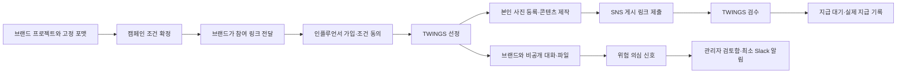

# KAIPER 캠페인 셀프서비스 — 설계·실행 기록

2026-10-16. 상태: 구현·로컬 회귀 검증·독립 소스 리뷰 완료, 운영 미반영. [실행 증거와 미검증 범위](../evidence/kapier-campaign/verification.md). 기준 커밋 `61b97f8dace63ec5e60cad792953691ea392442e`.

## 목표와 확정된 요청

TWINGS가 브랜드 전용 AI 영상 포맷을 설계한다. 브랜드는 캠페인 조건을 정하고 인플루언서에게 참여 링크를 전달한다. 인플루언서는 본인 TWINGS 계정으로 가입·동의·제작·게시 링크 제출을 수행한다. 브랜드 담당자와 참여자는 캠페인 안에서 대화하고 파일을 공유한다. 관리자는 검수와 지급 상태, 위험 신호를 처리한다.

- 브랜드의 플랫폼 결제를 목표에 포함한다. 실제 가격·수수료·환불 규칙은 아직 정하지 않았다.
- 대리 얼굴 등록·제작을 포함한 동의 흐름과 **약관 변경안**을 준비한다. 기존 약관을 즉시 변경하거나 본인 검증을 우회하라는 요청은 아니다.
- 위험 검토함과 새 Slack 채널을 사용한다. 의심 신호는 사람이 확인하며 자동 제재·자동 이체는 하지 않는다.
- Fable 계획 → GPT-6.1 Sol 구현 → Opus 5.5 리뷰. 모델별 실제 실행 결과를 별도로 남긴다.
- 관리자 UI는 기능명을 아는 사람만 쓸 수 있는 도구에서, 현재 상태·다음 행동을 설명하는 업무 화면으로 개선한다. 기존 TWINGS 디자인과 한국어/영어를 유지한다.

## 현재 확인된 사실

운영 DB 읽기 조회: 등록명 `KAIPER`; 연결 브랜드 프로젝트 0개, 제작 계약 0개. `campaign_productions`, `campaign_render_jobs` 테이블이 없다. 코드 존재와 운영 준비 상태를 혼동하지 않는다.

최신 소스에는 선정된 참여자의 브랜드 계약 수량 사용, 본인 사진 생성, 게시 링크 제출, 관리자 검수, 브랜드 게시물 연결, 지급 대기·수동 지급 기록이 있다. `docs/qa/campaign-self-service.md` 참조. 이 흐름은 재구현하지 않는다.

새로 필요한 연결은 참여 초대/가입 복귀, 참여자별 대화·파일, 브랜드 보상 조건 제안, 캠페인 결제, 대리 제작 동의, 위험 검토·Slack 알림, 관리자 정보구조다.

## 사용자 흐름

브랜드 결제는 별도 흐름인 **서비스 견적 발행 → 브랜드 소유자 수락 → 플랫폼 결제 → 제공사 결과 확인**으로 관리한다. 결제만으로 위 흐름의 선정·얼굴 사용 승인·검수·참여자 지급을 완료 처리하지 않는다. 대리 얼굴 등록은 동의·약관 변경안 검토 단계이며 현재 실행 경로는 본인 등록이다.

2026-10-16 Slack 비공개 채널 `twings-risk-review` (`C0C9DRS4DT7`) 생성 확인. 채널 생성은 자동 알림 연결 완료를 뜻하지 않는다. 브라우저 도구는 request-header policy 로딩 오류가 반복되어 운영 UI 직접 관찰은 미확인이다.

## 제품 원칙

1. 인플루언서는 본인 계정·인물 자산을 유지한다. 브랜드 멤버로 추가하지 않는다. 다른 브랜드 참여나 향후 추천은 별도 동의 범위다.
2. 캠페인 = 목적·포맷·기간·참여자·납품·보상의 단위. 브랜드 조직 = 담당자와 프로젝트를 담는 작업공간. 제작 공간은 캠페인의 단계이며 별도 경쟁 개념을 만들지 않는다.
3. `게시 링크 제출`, `검수 통과`, `지급 완료`는 각각 다른 상태다. 하나가 다른 하나를 자동으로 증명하지 않는다.
4. 브랜드 결제와 인플루언서 지급을 분리한다. 결제 완료만으로 캠페인 공개, 얼굴 사용 권한, 제작 시작, 지급 완료가 성립하지 않는다.
5. 대화는 브랜드와 해당 참여자만 공유한다. 다른 참여자의 보상·얼굴·개인정보·파일은 보이지 않는다. TWINGS 검토 접근은 목적과 이력을 남긴다.
6. 얼굴 자산은 본인 계정에 귀속한다. 브랜드가 올린 사진을 담당자의 본인 얼굴로 등록하지 않는다. 대리 제작은 인물·브랜드·캠페인·포맷·기간·용도별 명시적 승인과 제공사 호환성 확인이 필요하다.
7. 위험 분류기는 권한이 없는 판독기다. 메시지 속 명령을 실행하지 않으며, 결제·권한·제재·생성 기능을 호출할 수 없다.

## 권한·실행 경계

작업 브랜치 `codex/kapier-self-serve`, 경로 `D:/dev/.worktrees/twings/kapier-self-serve`. main 직접 push, 클라우드 migration, 실제 결제/지급, 실제 얼굴 생성, 캠페인 공개 및 고객 대상 발송은 이번 구현 검증에 포함하지 않는다. 약관 변경은 검토용 초안을 만들고 별도 승인 전 서비스 원문을 교체하지 않는다.

플랫폼 결제는 기존 `lib/brands/usage/payment.ts`의 서버 확정 견적·결제 확인·불명확 응답 대사 패턴과 `TossGateway`를 재사용할 수 있다. 소비자 렌더 주문이나 2차 활용 장부를 캠페인 결제로 재사용하지 않는다. 자동 지급 adapter는 현재 없다. [토스 지급대행 공식 안내](https://docs.tosspayments.com/guides/v2/payouts)를 기준으로 별도 계약·seller 등록·지급 결과 확인이 필요하다.

## 검증 기준

- 신규 가입/기존 계정 모두 초대 수락 후 원래 캠페인으로 복귀한다. 만료·철회·타인 토큰·중복 수락·동시 마지막 자리 검증.
- 캠페인 참여가 브랜드 멤버십을 부여하지 않는다. 다른 참여자 대화/첨부/보상/결과 접근을 차단한다.
- 기존 제작 예약·실패 수량 복구·관리자 승인 재시도·제공사 불명확 응답 가드를 유지한다.
- 메시지/파일/결제의 중복 제출과 권한 철회, 결제액 조작, 결제 중 타임아웃을 실제 DB 테스트로 검증한다.
- 위험 알림은 원문·얼굴·계좌·결제 키를 Slack에 보내지 않는다. 감지 실패와 전송 실패를 구분하고 중복 알림을 억제한다.
- 관리자 첫 방문에서도 브랜드 등록 → 캠페인 준비 → 포맷/계약 → 참여자 → 제작/납품 → 검수/지급 순서를 이해할 수 있다.
- TypeScript, 전체 Vitest, 로컬 production build/start, 익명 sweep. 브라우저 시각 확인과 실제 결제/생성 증거는 별도 표기한다.
