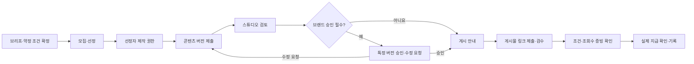

# TWINGS 제품 완성·앱 출시 설계안

작성·갱신: 2026-09-20 · 상태: **일반 사용자 생성 우선 확정 / 세부 설계 후보 / 구현·스토어 출시 완료 아님**

기준 소스 `c417e9a`와 현재 코드·공식 스토어 문서를 대조했다. 기존 [제품 결정](../TEMPLATES-IA.md), [캠페인 도메인](../CAMPAIGNS.md), [문구 진단](../wording/README.md)을 잇는 문서다. 충돌 시 대표의 최신 직접 지시가 우선한다.

## 1. 완성의 정의

TWINGS의 두 흐름을 끝까지 연결한다: **내 얼굴로 만들기**, **캠페인에 참여해 제작·게시·정산받기**. 브랜드는 결과와 승인할 일을 확인하고, 스튜디오는 예외 상황을 놓치지 않고 운영할 수 있어야 한다.

‘SOTA’는 기능 개수나 장식 수준이 아니라 아래 여섯 조건으로 판정한다.

1. 각 화면에서 현재 상태와 다음 행동을 바로 알 수 있다.
2. 성공·취소·실패·복구·권한 없음·빈 결과·오래된 데이터 상태를 모두 처리한다.
3. 돈·콘텐츠 버전·승인·권한 변경을 재시도해도 결과가 중복되거나 뒤집히지 않는다.
4. 한국어·영어 문구가 실제 서비스 절차와 일치한다.
5. 브랜드와 크리에이터의 데이터가 서버에서 분리되고 처리 이력이 남는다.
6. 앱은 실제 기기와 스토어 테스트 배포에서 핵심 흐름을 증명한다. PWA 설치나 에뮬레이터 스크린샷만으로 출시 가능 판정을 내리지 않는다.

## 2. 이미 정해진 것과 남은 결정

**확정된 방향**: 첫 앱은 일반 사용자 생성부터 출시한다(2026-09-20 대표 답변). 같은 사용자가 SNS 계정과 캠페인별 조건을 충족하면 캠페인에 참여할 수 있게 확장한다. 스튜디오 운영 + 브랜드 확인·승인 구조를 유지한다. 포지션·얼굴 검증·제공사 검수를 유지하고 스튜디오 내부 관리 권한을 브랜드에 주지 않는다.

**설계 권장안**: 브랜드·스튜디오 운영 도구는 우선 웹으로 제공한다. 캠페인은 팔로워 범위 등 지원 조건과 성과 목표를 별도로 설정한다. [SNS 연결·지표 설계](SOCIAL-CONNECTIONS.md)에 공식 API의 가능 범위와 측정 계약을 정리한다.

**현재 보류 유지**: 소비자 구독, 라이브 결제 전환, 결제수단 구성, 공개 플래그, 약관·환불정책 본문, 외부 발송 최종 문안. 이번 확장 지시만으로 이 항목들을 확정하지 않는다.

| ID | 결정할 것 | 권장안 | 왜 필요한가 |
|---|---|---|---|
| D01 확정 | 첫 출시 앱의 이용자와 기능 | 일반 사용자 생성부터. 동일 사용자가 조건을 충족하면 캠페인 참여 | 대표가 2026-09-20 선택. 유료 생성의 스토어 결제·가격·환불 연동을 첫 출시에서 검증해야 함. 브랜드·어드민 웹 우선은 설계 권장안 |
| D02 | 선정 크리에이터의 생성 비용·허용 횟수·실패 재시도 | 캠페인별 운영 계약에서 정하고, 소비자 단건 구매와 별도 권한으로 모델링 | 무료 무제한 생성이나 소비자 재결제를 임의로 가정할 수 없음 |
| D03 | 브랜드 승인 대상·필수 여부 | 브리프·대표 포맷·게시 전 콘텐츠 버전에 승인 가능. 캠페인별 필수 단계 명시 | 승인 지연이 게시 일정·정산을 자동 변경하면 안 됨 |
| D04 | 조회수 기준 시점·실제 지급 기한 | 현 문서의 검수 완료+대기기간을 시작점으로 정합성 검토, 실제 입금 기한 별도 | 현재 문구·입력 허용 상태·문서 간 차이가 있음 |
| D05 | 첫 출시 국가·OS·개발자 계정 소유자 | 한국 / iOS+Android / 야기워크숍 법인 계정 | 이름·연령등급·심사·세금·결제 프로그램·서명에 영향 |
| D06 | 조직 내부 역할과 지급 통제 | 운영·재무·권한관리 분리, 고위험 작업 재확인·이력 필수 | 실제 인원과 분장에 맞춰야 함. 2인 승인 의무 여부·금액 임계치는 미정 |

D01은 답변을 반영했다. 나머지는 의존 순서대로 확정하며 미답변 항목을 승인으로 취급하지 않는다. SNS 연동 가능성 조사는 실제 공급사 앱 권한 승인이나 API 연결 완료를 뜻하지 않는다.

## 3. 현재 구현과 출시 차이

| 영역 | 현재 근거 | 필요한 변화 |
|---|---|---|
| 결제 | 토스 PR #2: 서버 승인·중복 방지·렌더 실패 환불 | 대표의 클라우드 SQL 적용·라이브 전환·플래그 결정. 앱 디지털 구매는 별도 검토 |
| 문구 | PR #3: 1,491쌍 수집, 232쌍 AI 문맥 검토, 110쌍 후보 | 일반 문체 적용, 나머지 문구 검토, 정책 의미를 바꾸는 후보는 먼저 결정 |
| 캠페인 | `lib/campaigns/*`, `lib/admin/campaign-operations.ts`: 지원→선정→게시→검수→지급 | 생성 권한 연결, 게시 전 버전 검토, 조건 스냅샷, 조회수 증빙·리포트 |
| 어드민 | `/admin`, campaigns, inquiries, prompts, `/admin/do` | 처리 가능한 통합 작업 큐, 생성·환불 상세, 권한별 작업, 조회·변경 이력 |
| 브랜드 | 공개 의뢰 폼과 관리자 문의함 | 조직·초대·캠페인 소속, 서버에서 범위를 제한한 읽기/승인 API, 버전별 의사결정 |
| 모바일 | `app/manifest.ts`, `public/sw.js`: 최소 PWA·오프라인 안내 | 앱 탐색, 복귀 가능한 로그인, 업로드 복구, 푸시·딥링크, 탈퇴, iOS/Android 프로젝트·서명·실기기 검증 |

### 출시 전 재현·수정할 코드 위험

아래는 **소스 검토 결과**다. 이 설계 PR에서 실행 재현이나 운영 데이터 수정을 하지 않는다. 기능 PR에서 실패하는 회귀 테스트부터 작성한다.

- 알림 설정: 계정 페이지는 모든 로그인 사용자에게 폼을 보여주지만 `account/actions.ts`는 구형 유료 entitlement를 검사한다. 일반 사용자의 저장 성공 여부를 먼저 재현한다.
- 선정 인원: 현재 select는 인원 수를 읽고 서로 다른 지원 행을 각각 변경한다. 마지막 한 자리를 두 운영자가 동시에 선정하는 경쟁 상황을 검증한다.
- 캠페인 수정·상태 이동: 지원자 검수의 버전 검사와 달리 캠페인 자체 변경에는 동등한 충돌 방지가 부족하다. 오래 열린 탭의 덮어쓰기·모집 재개 충돌을 검증한다.
- 정산 금액: 지급 시점의 `campaign.payout`으로 계산한다. 공개 후 조건 변경이 기존 참여자의 금액에 영향을 주지 않도록 약정 조건을 버전으로 보존해야 한다.
- 대시보드의 생성 실패·보류 카운터는 상세 진입점이 없다. 처리할 수 없는 수치는 작업 큐로 연결한다.
- 탈퇴 운영 문서 `docs/RUNBOOK-deletion.md`는 과거 Stripe 구독과 초기 스키마를 기준으로 한다. 새 삭제 화면만 추가하지 않고 현재 토스 거래·캠페인·얼굴 제공사 자산·스토리지까지 삭제/법정 보존 범위를 다시 대조해야 한다. 이 설계 단계에서는 계정을 삭제하거나 기존 법무 문구를 바꾸지 않는다.

## 4. 역할별 경험

| 공간 | 첫 화면 | 주요 행동 | 성공 기준 |
|---|---|---|---|
| 일반 사용자 웹·앱 | 영상·이미지 템플릿 | 내 사진→가격·동의→해당 배포 채널의 결제→생성→저장·공유·문제 신고 | 이탈 후 복귀·중복 결제 방지·최종 실패 환불까지 이어짐. SNS 연결은 생성 이용의 필수 조건이 아님 |
| 동일 사용자의 캠페인 공간 | 지원 가능 캠페인 + 내 캠페인 | SNS 연결→지원 조건 확인→지원→선정→제작→수정→게시물·증빙 제출→정산 확인 | 담당 캠페인과 다음 행동이 분명하고 기한·실패가 복구 가능. 조건 충족과 선정은 별개 |
| 브랜드 웹 | 승인 요청 + 캠페인 진행 | 브리프 확인→버전별 콘텐츠 승인/수정 요청→게시 결과·리포트 | 자신의 캠페인만 보며 내부 비용·타 크리에이터 개인정보는 제외 |
| 스튜디오 어드민 | 처리할 일 | 건별 근거 확인→판단→다음 담당자/대상으로 전달 | 모든 숫자에서 실제 대상 목록으로 갈 수 있고 변경이 추적됨 |

### 일반 사용자 우선 앱 IA 후보

첫 출시 하단은 **만들기 / 내 작품 / 내 정보**를 후보로 한다. 만들기에서 영상·이미지 템플릿을 고르고 내 작품에서 생성 상태·결과·저장·공유·문제 신고를 이어간다. 캠페인 기능이 실제로 준비되면 **캠페인** 진입을 추가한다. 미구현 탭을 출시 화면에 노출하지 않는다.

캠페인 진입에서 SNS를 연결하고 지원 조건 충족·미충족·확인 필요를 구분한다. 일반 사용자의 생성 이용과 별도 가입·계정 전환을 요구하지 않는다. 참여 중에는 ‘수정 요청’, ‘제출 기한’, ‘검수 결과’를 우선 표시한다. 내 정보는 프로필·연결 계정·알림·지원·탈퇴를 담당한다.

선정 상세에서는 브리프·요구사항·내 약정 조건·기한·현재 버전·다음 행동을 같은 화면에서 읽는다. 업로드는 진행률·취소·다시 시도·백그라운드 복귀를 제공한다. 게시물 링크 제출 전에는 플랫폼·필수 광고 표기·해시태그를 점검하되 자동 검수로 오인시키지 않는다.

오프라인일 때 상태 변경·승인·지급은 실행하지 않는다. 재연결 후 최신 상태를 확인하고 재시도한다. 사진·토큰·브랜드 비공개 콘텐츠를 공용 서비스워커 캐시에 넣지 않는다. 승인되지 않은 자동 SNS 게시 기능은 추가하지 않는다.

### 브랜드 공간 후보 IA

**개요 / 승인 요청 / 콘텐츠 / 리포트 / 멤버**. 초대받은 조직만 선택 가능하다. 공유 URL을 알아도 멤버가 아니면 접근할 수 없다. 일반 브랜드 멤버와 승인자는 구분한다. 초대·역할 변경·멤버 해지는 조직 관리자 권한으로 제한하고 서버에서 즉시 반영한다.

브랜드 승인 화면은 미디어, 버전, 브리프 체크 항목, 이전 수정 요청, 사용 가능 범위를 한곳에 보여준다. ‘이 버전 승인’과 ‘수정 요청’은 특정 버전에만 적용된다. 승인 뒤 새 버전을 올리면 이전 승인은 이력으로 남고 새 버전은 다시 검토해야 한다.

리포트는 발행된 시점의 스냅샷이다. 조회수 합계·중위값·게시 완료 수에는 분모, 수집 시각, 출처, 미집계 수를 붙인다. 데이터가 없는 항목은 0으로 채우지 않는다. 내부 원가·마진·개인 연락처·지급 참조는 제외한다. 실제 API 연동 없이 ‘실시간 성과’라고 쓰지 않는다.

## 5. 어드민 설계

클릭 가능한 후보: [admin-prototype.html](admin-prototype.html). **예시 데이터·메모리 안의 동작만 있는 설계 시안**이며 운영 화면에 배포하지 않는다.

### 정보 구조

| 그룹 | 메뉴 | 맡는 일 |
|---|---|---|
| 업무 | 오늘 할 일 | 미배정, 내 담당, 지연, 검토 대기. 우선순위→기한→접수 순 정렬 |
| 업무 | 캠페인 | 진행 단계, 일정, 브리프, 지원자, 콘텐츠 버전, 브랜드 승인, 게시·정산 |
| 업무 | 브랜드 | 의뢰→조직→캠페인 연결, 담당자·멤버·초대 상태 |
| 업무 | 크리에이터 | 캠페인별 참여 이력, 콘텐츠·정산 상태, 필요한 최소 프로필 |
| 운영 | 생성·환불 | 생성 작업과 주문을 나란히 추적, 실패 사유, 자동 환불 지연, 허용된 재처리 |
| 운영 | 정산 | 조건 미충족 / 증빙 확인 / 지급 기록 / 지급 완료. 실제 송금과 기록을 분리 |
| 운영 | 문의·신고 | 콘텐츠 문제·초상권 신고·브랜드 문의의 담당자·기한·처리 결과 |
| 설정 | 템플릿 | 미디어·가격·엔진 설정·사전 미리보기·공개 준비 상태 |
| 설정 | 알림 | 발송 대기·성공·실패·재시도, 동의와 템플릿 버전 |
| 설정 | 권한·기록 | 멤버 권한, 민감 작업 기록, 변경 전후 값·원인·실행 결과 |

### 핵심 화면 A — 오늘 할 일

높이 큰 지표 카드 대신 작업 목록을 첫 화면에 둔다. 행에는 **해야 할 일 / 캠페인·대상 / 이유 / 기한 / 담당자 / 상태 / 다음 행동**을 둔다. 오른쪽 패널에 증빙·댓글·이력과 작업 버튼을 배치한다. 검색·필터·정렬은 URL에 남겨 동료가 같은 목록을 열 수 있게 한다.

새 문의, 선정 필요, 제출 지연, 브랜드 승인 대기, 검수 필요, 정산 가능, 환불 지연, 초상권 신고를 각각 원본 상태에서 계산한다. 큐에 나타난다는 이유만으로 권한을 얻지 않는다. PII를 포함한 자유 검색 결과·내보내기는 역할과 조직 범위를 적용한다.

일괄 작업은 대상 수·현재 필터·변경 결과를 미리 보여준다. 지원자 선정·지급·권한 변경은 무조건적인 ‘전체 승인’에 넣지 않는다. 처리 도중 일부 항목이 바뀌면 항목별 성공/충돌을 표시하고 재처리를 유도한다.

### 핵심 화면 B — 캠페인 작업 공간

상단은 단계와 마감일, 본문 탭은 **개요 / 지원자 / 제작·승인 / 게시·검수 / 정산 / 리포트 / 활동**. 캠페인 상태와 콘텐츠 버전 상태를 혼합하지 않는다.

선정 시점의 약정 버전을 참여 건에 연결한다. 수정 조건을 과거 참여자에게 소급 적용하지 않는다. 변경 협의가 필요한 경우 새 버전과 수락 이력을 만든다. 마감 연장·선정 철회·게시 삭제·승인 철회는 정책과 영향 대상이 보이는 명시적 처리로 만든다.

### 핵심 화면 C — 생성·환불

주문·렌더·검수·환불을 독립 상태로 표시한다. 생성 실패가 환불 완료를 뜻하지 않는다. 환불 요청→제공사 확인→환불 완료/재처리 필요를 구분한다. 타임아웃은 결과 불명으로 처리하고 주문을 먼저 조회한다. 중복 클릭으로 재과금·이중 환불·동시 렌더가 생기지 않아야 한다.

오류는 운영자가 이해하는 요약·발생 시각·시도 횟수·연결 식별자까지만 표시한다. 시크릿·인증 헤더·얼굴 원본·DB 원문 오류를 화면이나 로그에 노출하지 않는다. 얼굴 검수 보류를 일반 재시도 버튼으로 풀 수 없게 한다.

### 핵심 화면 D — 정산

원고료 조건, 조건 버전, 검수일·대기 종료일, 조회수 출처·측정시각·증빙, 계산 내역, 실제 지급 근거를 함께 표시한다. ‘정산 대상’과 ‘지급 완료’를 분리한다. 은행 연결이 없는 동안 버튼은 **지급 내역 기록**이다. 참조번호 없이 완료하는 예외는 이유·권한·감사 정책을 별도 결정한다.

### 화면 품질 기준

- 기존 흑백 + 파랑 `#0000ee` 유지. 장식용 차트·그라데이션·마케팅 히어로 대신 명확한 표와 상세 패널.
- 목록·검색·상세·돌아가기의 위치와 용어 일관. 한 번에 하나의 주요 행동.
- 로딩 중 기존 데이터와 갱신 상태 구분. 오류 시 입력 보존, 재시도 제공. 데이터 없음과 권한 없음을 분리.
- 키보드 탐색·뚜렷한 포커스·스크린리더 상태 안내. 작은 화면에서는 우선 열만 남기고 상세 패널은 전체 화면으로.
- 시안은 한글 중심. 실제 반영은 KO/EN 사전과 모든 상태 문구를 같이 구현하고 확인한다.

## 6. 서버 권한·데이터 계약

### 역할별 최소 권한 후보

| 작업 | 크리에이터 | 브랜드 열람자 | 브랜드 승인자 | 스튜디오 운영 | 재무 | 권한관리 |
|---|---|---|---|---|---|---|
| 캠페인 공개 정보 | 읽기 | 읽기 | 읽기 | 관리 범위 | 읽기 | 읽기 |
| 참여·제출 | 본인만 | 불가 | 불가 | 담당 범위 | 읽기 최소 | 기본 불가 |
| 브랜드 비공개 화면 | 불가 | 소속 조직 | 소속 조직 | 배정 조직 | 필요한 금액만 | 기본 불가 |
| 버전 승인 | 불가 | 불가 | 지정 승인 대상 | 운영 검토 별도 | 불가 | 불가 |
| 선정·게시물 검수 | 불가 | 불가 | 불가 | 허용 | 불가 | 불가 |
| 실제 지급 내역 기록 | 불가 | 불가 | 불가 | 기본 불가 | 허용 | 기본 불가 |
| 조직 초대·역할 관리 | 불가 | 불가 | 별도 권한 필요 | 별도 권한 필요 | 불가 | 허용 |

권한명은 제안이며 실제 인원에 맞춰 D06에서 확정한다. 관리자가 모든 캠페인의 개인정보를 무제한 읽는 것을 기본값으로 삼지 않는다. 비상 소유자 권한은 별도 기록과 사유를 요구한다.

새 테이블 후보: 브랜드 조직·멤버·초대, 캠페인과 브랜드 관계, 캠페인 조건 버전, 제출물·버전, 승인 요청·결정, 메트릭 증빙, 발행 리포트, 작업 배정, 알림 이벤트/전달, 권한·감사 기록. 아직 SQL을 만들거나 번호를 예약하지 않는다.

원칙:

- 서버가 세션에서 사용자와 멤버십을 확인한다. 요청의 organizationId·creatorId만 신뢰하지 않는다.
- 서비스 롤을 쓰는 저장소에서는 RLS만으로 격리를 보장한다고 주장하지 않는다. 모든 조회·서명 URL 발급에 객체 범위를 검사한다.
- 기존 관리자 변경은 `/admin/do` 레지스트리를 유지한다. 브랜드 승인·크리에이터 제출은 별도 좁은 서비스에서 같은 도메인 검증을 재사용한다.
- 버전 검사와 트랜잭션을 사용하고, 선정 인원 제한은 캠페인 단위 동시성으로 보장한다.
- 승인 이벤트에 대상 버전·행위자·조직·시각·이유·요청 ID를 기록한다. 같은 버전의 중복 승인 요청은 한 번만 반영한다.
- 외부 메일·푸시는 도메인 변경의 성공과 구분한다. 커밋 후 유실될 수 있는 직접 발송을 내구성 있는 알림 기록과 재시도로 발전시킨다.
- 얼굴 원본·계좌·주민번호를 감사 JSON에 복사하지 않는다. 조회 권한 변경·다운로드 이력도 필요한 범위로 기록한다.

## 7. 모바일 구현 경로

기존 ‘PWA 먼저, 카메라·푸시가 필요해지면 Expo’ 결정을 이어간다. 웹 도메인 서비스를 먼저 안정화하고 **Expo/React Native 앱을 별도 클라이언트로 추가하는 방안**을 권장한다. 일반 사용자 생성 우선 결정에 맞춰 스토어 구매·복원·환불과 사진→인증→생성→저장 흐름을 첫 출시 경로로 설계한다. 기술 선택과 배포 국가·OS·결제 방식은 별도 확정한다.

| 경로 | 얻는 것 | 제약·판정 |
|---|---|---|
| PWA 강화 | 현재 웹과 빠르게 공유, 링크 진입·설치 | 웹 배포 완료로 스토어 앱 출시 완료를 주장하지 않음 |
| Capacitor 등 웹 기반 네이티브 | 기존 화면 재사용 | 단순 웹 포장 심사 위험, OAuth·카메라·푸시·결제 경계는 별도로 구현·검증 필요 |
| Expo/React Native | 앱 탐색·카메라·공유·푸시·딥링크를 모바일 흐름으로 구성 | 별도 UI·API 세션 설계와 iOS/Android 검증 비용. 권장 후보 |

공유 대상은 스키마·상태 전이·권한 규칙·사전 의미·API 계약이다. Next 서버 컴포넌트·쿠키 기반 server action을 네이티브 화면에 그대로 넣지 않는다. 기존 웹은 유지하며 전체 모노레포 전환은 별도 ADR 필요성을 평가한다.

앱 인증은 OS 브라우저 + PKCE, 등록된 redirect URI·Universal/App Links, 검증된 토큰과 안전한 기기 저장소를 사용한다. 계정 연결은 검증된 프로바이더 ID에 기반하고 이메일 문자열 일치만으로 병합하지 않는다. 토큰 만료 후 원래 작업으로 복귀하되 결제·승인은 최신 상태를 재확인한다.

### 스토어 정책을 반영할 지점

Apple은 웹사이트를 단순 포장한 앱보다 충분한 앱 경험을 요구하고, 계정 생성 앱에는 앱 내 삭제를 요구한다. 유료 디지털 기능은 인앱결제가 기본이며 국가별 예외·승인 프로그램을 별도 확인해야 한다. 따라서 웹 토스 결제를 앱에 그대로 넣는 것을 전제로 하지 않는다. [Apple 심사 가이드라인 §3.1.1·§4.2·§5.1.1](https://developer.apple.com/app-store/review/guidelines/)

Google Play도 앱 디지털 기능 결제에 기본 결제 정책과 국가·프로그램 예외를 둔다. 적용 국가와 프로그램 참여를 확정하기 전 외부 결제 유도 경로를 넣지 않는다. [Google Play Payments](https://support.google.com/googleplay/android-developer/answer/9858738)

Google의 계정 생성 앱은 앱 내 삭제 경로와 앱 외부의 삭제 요청 웹 경로가 필요하다. 현재 메일 문의만 있는 탈퇴 경험을 출시 기준으로 간주하지 않는다. [계정 삭제 요구사항](https://support.google.com/googleplay/android-developer/answer/13327111), [Apple 계정 삭제 안내](https://developer.apple.com/support/offering-account-deletion-in-your-app/)

위 내용은 2026-09-20 확인한 설계 입력이다. 제출 때 다시 확인한다. App Store·Play 심사 통과 자체를 기술 구현 완료와 같은 보장으로 표현하지 않는다. 소셜 로그인, 사용자 콘텐츠 신고·차단·운영, 연령·얼굴 데이터 처리 고지도 앱의 실제 범위에 맞춰 검토한다.

Expo EAS는 iOS/Android 설치 바이너리를 만드는 선택지다. 계정·서명·기기 테스트가 준비되기 전에는 빌드·제출 성공을 주장하지 않는다. [공식 EAS Build 문서](https://docs.expo.dev/build/introduction/)

## 8. 출시 판정표

아래 수치·상태는 **목표**, 현재 실측이 아니다. 실제 베타 결과와 지원 기기를 함께 기록한다.

| 게이트 | 통과 증거 | 현재 |
|---|---|---|
| G1 도메인 신뢰성 | 마지막 자리 동시 선정, 약정 변경, 중복 승인, 타임아웃 재시도 테스트 | 미구현·미검증 |
| G2 권한 격리 | 조직 A/B·탈퇴 멤버·만료 초대·URL 직접 접근·미디어 URL 발급 거절 | 브랜드 조직 모델 없음 |
| G3 제작→환불 | 일반 사용자 테스트 결제/취소/생성/최종 실패/환불, 관리자 무과금·플래그 게이트 | 웹 테스트 결제는 PR #2 증거. 앱은 미검증 |
| G4 캠페인 전 과정 | 지원→선정→허용된 생성→버전 수정→브랜드 승인→게시 검수→증빙→지급 기록 | 부분 구현 |
| G5 모바일 복구 | iPhone·Android 실기기에서 OAuth 복귀, 권한 거부, 네트워크 단절, 업로드 재시도, 앱 재시작 | 미검증 |
| G6 알림·개인정보 | 수신 동의 저장, 중복 방지, 푸시 거부 대체 경로, 토큰 폐기, 계정 삭제·보관 예외 | 메일 일부만 구현 |
| G7 사용성 | 360·390·768·1440px에서 핵심 행동 접근, 가로 잘림 없음, 키보드·스크린리더 주요 흐름 | 시안에서 제한 검증 예정 |
| G8 성능 | 실데이터 상당 부하에서 목록 API·초기 표시·미디어 지연 측정, 누락 페이지네이션 점검 | 기준 데이터·예산 설정 필요 |
| G9 운영 | 상태별 지연 감지, 환불 미완료·발송 실패 경보, 담당자·운영 매뉴얼, 백업 복구 리허설 | 부분 구현 |
| G10 스토어 패키지 | 서명된 iOS/Android 빌드, TestFlight/Play 테스트 트랙, 심사용 계정·설명·스크린샷·개인정보 양식 | 계정·범위 확정 필요 |

치명적 오류·교차 조직 데이터 노출·중복 지급/과금·실패 은폐는 0건이어야 한다. 웹과 앱 버전 불일치를 허용하는 API 호환 정책·점진 배포·중단 플래그를 준비한다. 운영 데이터 기반 성과나 안정성 수치를 만들어 넣지 않는다.

## 9. 한 작업씩 실행할 순서

각 행은 별도 작업 메시지·브랜치·PR로 진행한다. 일반 사용자 생성 우선 답변을 반영해 캠페인 확장이 첫 앱 출시를 막지 않도록 순서를 조정했다. 어드민 설계는 함께 구체화하되 캠페인 데이터 기능은 별도 구현한다.

| 순서 | 작업 | 완료 기준 |
|---|---|---|
| 0 현재 | 제품·어드민 설계와 앱 범위 확정 | 이 문서·시안, 현재/제안/미검증 구분. D01 일반 사용자 생성 우선 답변 반영 |
| 1 | 일반 사용자 생성·계정 기반 | API 인증 경계, 사진 업로드·인증 복귀·생성 상태·실패 복구, 알림 저장·탈퇴 계약을 테스트로 보호 |
| 2 | 일반 사용자 앱 첫 출시 경로 | 인증/딥링크/사진/생성/내 작품/공유·저장/알림·탈퇴, 스토어 결제 결정 반영. 캠페인 기능보다 먼저 출시 |
| 3 | 캠페인 신뢰성과 어드민 업무 화면 | 동시 선정·버전 충돌·조건 스냅샷, 통합 작업 큐·생성/환불 상세·정산 근거·감사 기록 |
| 4 | SNS 연결과 캠페인 확장 | 공식 API의 소유 계정 연결, 캠페인별 지원 조건·측정 가능한 목표, 지금 할 일·제출 복구·정산 상태 |
| 5 | 브랜드 확인·승인 공간 | 조직 격리, 멤버 초대·회수, 버전별 승인/수정 요청, 발행 리포트 |
| 6 | 전체 문구·접근성·출시 검증 | 남은 문구 검토, 실제 기기 E2E, 테스트 배포, 제출 자료와 운영 매뉴얼 |

캠페인 생성 비용 D02가 정해지기 전에는 무료 생성 권한을 발급하지 않는다. D03 이전에는 브랜드 승인을 지급 조건에 자동 연결하지 않는다. 기능 PR은 AGENTS.md §3의 tsc→vitest→build:local→start:local→sweep 전부와 각 화면·권한 검증을 수행한다.

## 10. 다음 작업 지시 초안 — 일반 사용자 생성·계정 기반

작업: 일반 사용자 생성 앱의 첫 출시를 위해 현재 웹의 생성·계정 흐름과 네이티브 API 경계를 연결 가능한 계약으로 정리하고, 확인된 기능 불일치를 회귀 테스트로 보호한다.

범위: 인증·계정·렌더의 기존 서비스와 관련 API·테스트, 앱 클라이언트 계약 문서. 실제 변경 경로는 진단 후 작업 시작 메시지에서 좁힌다. SNS 연결·브랜드 권한·캠페인 선정·가격·법무 본문은 별도 작업.

읽기: AGENTS.md 전부, 현재 인증/렌더/토스 결제 계약, 이 문서 §3·§7·§8, 계정 설정과 기존 권한 테스트.

완료 기준: 일반 사용자 알림 저장 불일치를 재현·수정; 세션에서 본인 작업만 조회·조작할 수 있는 API 계약과 누락 권한/만료/중복 요청 검증; 생성·인증 복귀·실패 환불의 현재 보장과 앱에서 추가할 동작 구분. 얼굴 검수·공개 플래그·결제 증거 검증 유지.

검증: 실패 재현→회귀 테스트→AGENTS.md §3 전체 루프, 일반 사용자 브라우저 확인. 앱 미구현 동작은 통과로 보고하지 않는다.

브랜치: `codex/consumer-app-foundation` 후보. 병합 상태 확인 후 올바른 base에서 별도 PR. main 직접 push 금지. SQL이 필요하면 파일과 ‘클라우드 적용 필요’ 표시만.

결정 보류: 스토어 배포 국가·OS·개발자 계정, 앱 결제 상품·가격·환불 정책. 웹 토스 결제를 앱에 자동 이식하거나 구독을 재개하지 않는다. 계정/API 기반의 독립 작업은 먼저 진행할 수 있다.
