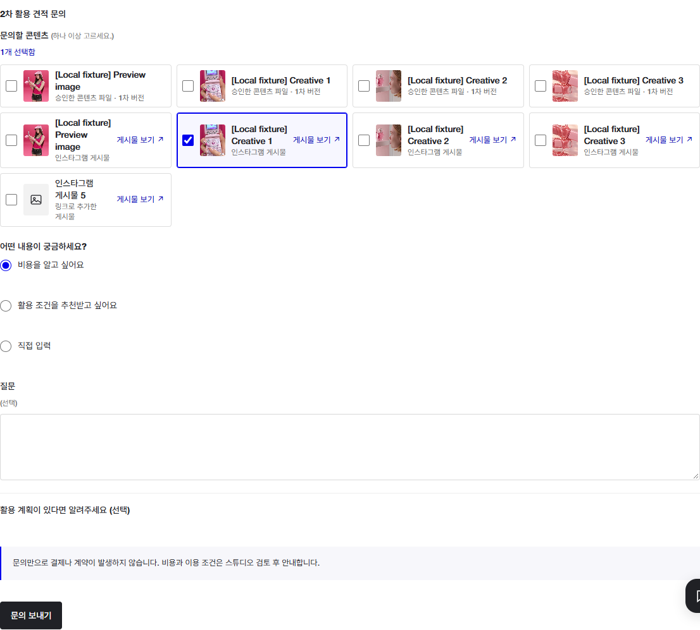
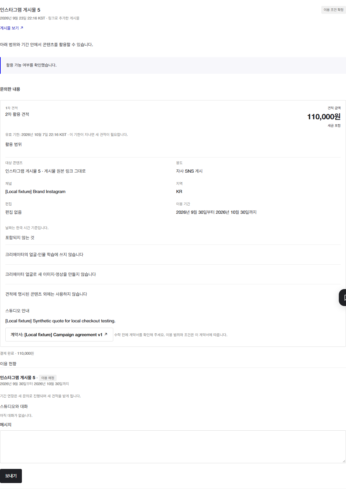

# 2차 활용 구현 검증 — 2026-09-23

기준: main `1d4b406`, 작업 브랜치 `codex/secondary-usage`. 운영 배포·클라우드 DB 적용·실결제·메일 발송은 하지 않았다.

## 구현과 검토

- Claude Code `claude-opus-5-5`: 구현, 독립 서버 검토, 회귀 수정, 문의 화면 개선.
- Claude Code `claude-opus-4-6`: 실제 KO/EN 사전 문안 검토. 동작과 충돌하는 안내를 수정하고, 계약서 확인 의무는 유지했다.
- Codex: 변경 내용 확인, 최종 검증 루프, 로컬 화면·가짜 결제 검증.
- 기본 문의는 대상 콘텐츠와 문의 목적만으로 접수한다. 기간·채널·예산은 선택 입력이다.
- 운영자의 크리에이터 보상·동의 증빙은 고객 DTO에서 제외한다. 고객은 확정된 활용 범위·계약서·최종 견적을 확인한다.

## 최종 자동 검증

| 명령 | 결과 |
| --- | --- |
| `npx tsc --noEmit` | 통과 |
| `npx vitest run` | 172개 파일 · 1,855개 테스트 통과 |
| `npm run build:local` | 통과 |
| `npm run start:local` | 3000 포트 프로덕션 서버 기동 확인 |
| `npm run sweep:anon` | **SWEEP PASSED — 664/664** |
| `npm run db:local` | 새 마이그레이션과 문의·견적 픽스처 적용 성공 |
| `git diff --check` | 통과 |

리뷰 회귀: 운영 환경의 test/fake 결제 차단, 확인 불가 주문 재처리와 큐 정체 방지, 부가세 포함 최종 금액만 결제, 미구현 원본 파일 제공 차단, 운영자의 고객 대리 승인 차단, 팀 권한 변경 시 구매 권한 철회, 만료 이용 기간 차단, 확정 후 동의 철회 시 이용 보류. 브랜드 호스트·CSRF·익명 차단·일일 복구 작업도 검증했다.

## 로컬 브라우저 검증

- 일반 브랜드 소유자 픽스처로 게시물의 문의 버튼 → 대상 자동 선택 → 기간·예산 없는 비용 문의 접수 확인.
- 콘텐츠 제목·썸네일, 접힌 선택 조건, 접수 상태·대화 입력 확인.
- 데스크톱 및 모바일 390px 확인. 모바일 콘텐츠 너비 390px, 가로 넘침 없음. 언어 선택기로 KO → EN 전환 확인. 페이지 JS 오류 없음.
- 로컬 합성 견적 수락 → **fake 게이트웨이** 결제 → 이용 조건 확정 및 합의 기간의 이용 예정 표시 확인. 실제 청구나 토스 테스트 카드 인증을 수행한 검증은 아니다.
- 관리자 픽스처로 문의함·문의 상세·견적·결제 담당자·기록 화면 접근 확인. 페이지 JS 오류 없음.

아래 이미지는 **로컬 테스트 데이터**이며 실제 브랜드 견적·가격 제안이 아니다.

## 배포 전 남은 단계

- **클라우드 적용 필요:** `0037_core_brand_usage_licensing.sql` → `0123_glue_brand_usage_licensing.sql`. 이번 작업에서는 파일만 추가했다.
- `BRAND_USAGE_PAYMENTS`는 기본 닫힘. 운영에서는 live 토스 설정도 필요하다. 문의·견적 확인은 결제 플래그와 독립이다.
- 대표가 취소·환불 정책과 결제 고지, 구매 담당자 정책 및 결제 공개 시점을 확정해야 한다. 기존 법무 문서는 수정하지 않았다.
- 원본 파일 전달·자동 알림·예상 견적 추정기는 범위 밖이다. 예측용 거래 이력 구조만 준비했다.
- 실 토스 승인·신규 OAuth·메일 수신은 이번 검증에서 수행하지 않았다.

운영 절차와 상세 제약: [SECONDARY-USAGE.md](../SECONDARY-USAGE.md).
